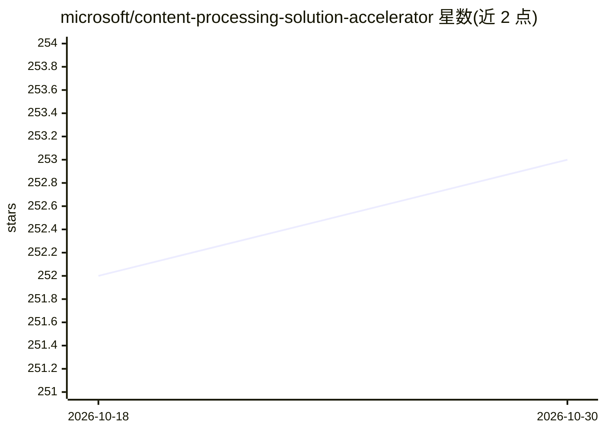

# microsoft/content-processing-solution-accelerator

⭐ 253 · Python · MIT · 推送 2026-10-28 · [GitHub](https://github.com/microsoft/content-processing-solution-accelerator) · [官网](https://github.com/microsoft/solution-accelerators/) · 组织维护

**面向企业的多文档非结构化内容抽取与理赔处理方案加速器**

微软的 Azure 解决方案加速器：通过 Web UI 将多份文档（发票、表单、图像、合同）上传至同一理赔案件，由基于 Agent Framework Workflow Engine 的 DAG 工作流编排，逐文档执行 Extract→Map→Evaluate→Save 四阶段抽取管线（含置信度评分与模式映射为 JSON），再跨文档生成 AI 摘要与缺口分析。底层调用 Azure AI Foundry、Azure OpenAI GPT-5.1、Azure AI Content Understanding 与 Cosmos DB 等服务，通过 azd 部署到用户自己的 Azure 订阅，需相应订阅权限与配额，按用量计费。示例场景为车险 FNOL 理赔。

## 筛选速览

| 维度 | 判定 | 备注 |
|---|---|---|
| AI 角色 | `ai-native` | 本体是模型或模型工具 |
| 许可风险 | `permissive` | MIT |
| 部署形态 | `None` |  |
| 模型依赖 | locked-api |  |
| 硬件要求 | — | 无带数字的原话,不猜 |
| 安装摩擦 | `low` | 无编译、无系统依赖或容器化 |
| 成熟度 | — | 结构信号不足 |

## 能力要点

- DAG 工作流引擎编排文档抽取、摘要与缺口分析，支持重试与死信队列
- 4 阶段管线（Extract→Map→Evaluate→Save）含实体抽取与模式映射的置信度评分
- YAML DSL 无代码编写缺口分析规则，规则可跨行业复用
- 多模态处理：文本、图像、表格与图表（OCR + GPT-5.1 Vision）

## 适用场景

- 保险理赔中批量处理表单、警方报告、维修估价与照片并做缺口分析
- 合同审查、发票处理、ID 核验等多文档业务流程
- 需要人工在环复核抽取结果的合规场景

## 场景标签

`文档解析` · 领域:知识与检索

## 证据(README 行号)

> L7: Process multi-document claims by extracting data from each document, applying schemas with confidence scoring, and g
> L20: - **Content Processing Pipeline** — The core engine (carried forward from v1) that processes each individual docume
> L97: - **AI-powered summarization & gap analysis**

## 星数曲线

2026-10-18 252 → 2026-10-30 253（+1）

---
*卡片 v1 · prompt 1.4 · 生成 2026-10-22 · 置信度 high · 依据 README sha `154279d7735b` · [字段定义](../../DATASET.md)*
