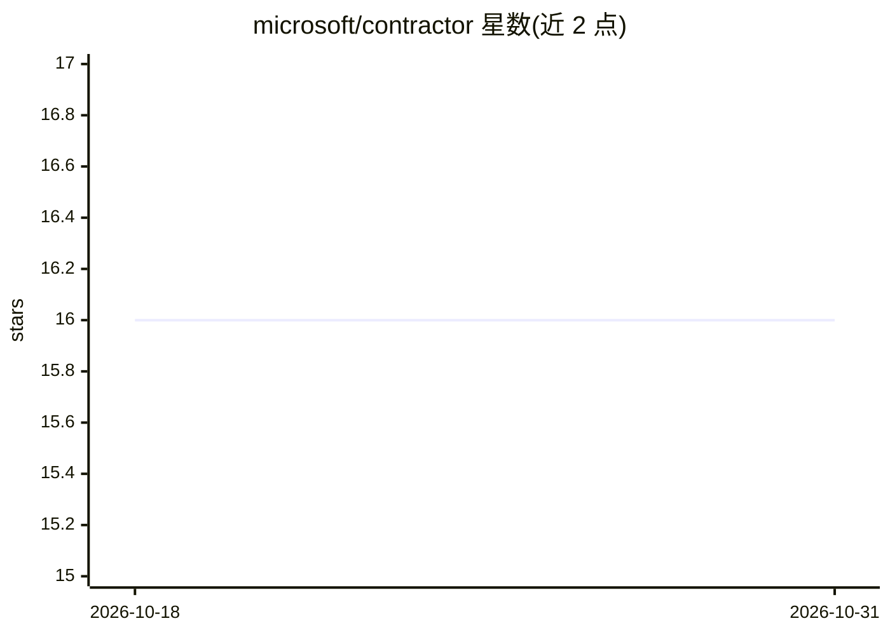

# microsoft/contractor

⭐ 16 · Jupyter Notebook · MIT · 推送 2026-02-20 · [GitHub](https://github.com/microsoft/contractor) · 组织维护

**评估贷款与安全合同的多模态 agentic RAG 应用**

基于 Semantic Kernel 的多智能体应用：分析贷款与安全合同的条款与财务条件，从内部数据源与网络（Bing API 检索法院记录、社交信息）获取并核验承包商信息，输出风险、合规与治理反馈。采用 Agent Swarm 模式，由推理模型编排专项智能体；支持文本、图像、音频、视频多模态处理，数据存于 Cosmos DB，通过 FastAPI 提供服务，部署面向 Azure Container Apps。依赖 Azure OpenAI 等多项云服务，需 Poetry 安装并运行配置脚本。

## 筛选速览

| 维度 | 判定 | 备注 |
|---|---|---|
| AI 角色 | `ai-native` | 本体是模型或模型工具 |
| 许可风险 | `permissive` | MIT |
| 部署形态 | `None` |  |
| 模型依赖 | locked-api |  |
| 硬件要求 | — | 无带数字的原话,不猜 |
| 安装摩擦 | `low` | 无编译、无系统依赖或容器化 |
| 成熟度 | — | 结构信号不足 |

## 能力要点

- Agent Swarm 模式：推理模型编排多个专项智能体做合同分析
- Bing API 网络检索核验承包商公开记录（法院文件、社交数据）
- 多模态插件处理文档、图像、音频、视频
- FastAPI 服务 + Cosmos DB 结构化存储

## 适用场景

- 签约前评估承包商履约能力与信用风险
- 对贷款和安全合同做合规与治理审查
- 结合内部数据与公开记录核验承包商信息

## 场景标签

`多智能体` `RAG` `多模态` · 领域:Agent 开发

## 证据(README 行号)

> L3: A multi-modal, agentic RAG implementation with Semantic Kernel that manages multi-modal information for chat applica
> L7: The Contractor is an application that implements a multi-agent system capable of evaluating the security and quotiza

## 星数曲线

2026-10-18 16 → 2026-10-31 16（+0）

---
*卡片 v1 · prompt 1.4 · 生成 2026-10-30 · 置信度 high · 依据 README sha `c59199cb4498` · [字段定义](../../DATASET.md)*
