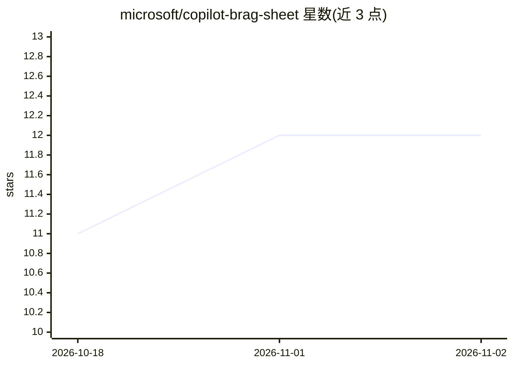

# microsoft/copilot-brag-sheet

⭐ 12 · JavaScript · MIT · 推送 2026-10-31 · [GitHub](https://github.com/microsoft/copilot-brag-sheet) · 组织维护

**自动记录 Copilot CLI 编码会话为结构化工作成果日志的扩展**

GitHub Copilot CLI 扩展（joinSession 扩展，非插件），在会话中后台自动记录仓库、分支、编辑文件、PR 与 git 操作，以结构化 JSON 本地存储（原子写入、孤儿记录恢复），并提供三个 MCP 工具：save_to_brag_sheet 保存成果条目、review_brag_sheet 回顾近期记录、generate_work_log 生成 Markdown 工作日志。面向需要绩效/晋升材料的开发者；要求 Node.js 18+ 与 Copilot CLI 订阅，自动追踪依赖实验性 API，MCP 主机中仅工具可用。

## 筛选速览

| 维度 | 判定 | 备注 |
|---|---|---|
| AI 角色 | `ai-ecosystem` | LLM/agent 周边工具 |
| 许可风险 | `permissive` | MIT |
| 部署形态 | `library` | 以包/库形式分发 |
| 模型依赖 | — | README 未给出锁定关系 |
| 硬件要求 | — | 无带数字的原话,不猜 |
| 安装摩擦 | `low` | 无编译、无系统依赖或容器化 |
| 成熟度 | `idea` | |

## 能力要点

- 会话自动追踪文件/PR/git 操作，本地 JSON 存储，零遥测
- 三个 agent 可调用工具：保存条目、回顾记录、生成 Markdown 工作日志
- 崩溃安全：原子写入、紧急保存与孤儿记录恢复
- npm 安装或一键脚本安装，支持 Windows/macOS/Linux

## 适用场景

- 绩效评审或晋升答辩前生成有据可查的工作影响日志
- 日常编码时自动留档会话活动，季度汇总 shipped 内容
- 让 Copilot CLI 回溯扫描 git 历史/PR 补全过往记录

## 场景标签

 · 领域:开发者工具

## 证据(README 行号)

> L9: A GitHub Copilot CLI extension that silently records your work as you go — files edited, PRs created, git actions — 
> L47: Plus three tools the agent can call on your behalf:
> L60: |**MCP hosts** (Claude, Cursor, VS Code)|✅ Full|⚠️ Phase 2|Beta|

## 星数曲线

2026-10-18 11 → 2026-11-02 12（+1）

---
*卡片 v1 · prompt 1.4 · 生成 2026-11-01 · 置信度 high · 依据 README sha `ac338a82488c` · [字段定义](../../DATASET.md)*
