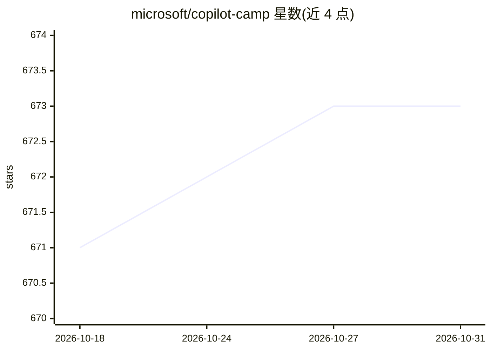

# microsoft/copilot-camp

⭐ 673 · C# · MIT · 推送 2026-10-28 · [GitHub](https://github.com/microsoft/copilot-camp) · 组织维护

**微软官方 Microsoft 365 Copilot 扩展开发实训课程仓库**

微软维护的虚拟训练营托管仓库，面向要为 Microsoft 365 Copilot 构建代理与连接器的开发者。内容按学习路径组织：声明式代理扩展（含 MCP 服务器、多代理工作流、API 插件、Copilot Connectors 等 5 个 bundle）、自定义引擎代理（M365 Agents SDK + Semantic Kernel 或 Agent Framework）、Copilot Cowork 扩展、SharePoint 代理与应用。仓库另含 Markdown 拼写检查脚本（pip 安装依赖后运行）与社区讨论入口。

## 筛选速览

| 维度 | 判定 | 备注 |
|---|---|---|
| AI 角色 | `ai-knowledge` | 知识聚合/清单类 |
| 许可风险 | `permissive` | MIT |
| 部署形态 | `library` | 以包/库形式分发 |
| 模型依赖 | — | README 未给出锁定关系 |
| 硬件要求 | — | 无带数字的原话,不猜 |
| 安装摩擦 | `low` | 无编译、无系统依赖或容器化 |
| 成熟度 | — | 结构信号不足 |

## 能力要点

- 声明式代理 5 个实训 bundle（MCP 服务器、多代理编排、API 插件、连接器等）
- 自定义引擎代理双路径：M365 Agents SDK + Semantic Kernel / Agent Framework
- Copilot Cowork 与 SharePoint 代理扩展学习路径
- 提供 Markdown 拼写检查脚本（支持 --fix 与自定义忽略词）

## 适用场景

- 学习为 Microsoft 365 Copilot 开发代理与连接器
- 实操构建 MCP 服务器与多代理工作流
- 从零构建带文档搜索与视觉分析的生产级代理

## 场景标签

`教程课程` · 领域:学习与行业

## 证据(README 行号)

> L3: This repo is for hosting a virtual workshop for developers who want to build agents and connectors for Microsoft 365
> L9: Copilot Developer Camp offers multiple hands-on learning paths depending on your role and scenario:

## 星数曲线

2026-10-18 671 → 2026-10-31 673（+2）

---
*卡片 v1 · prompt 1.4 · 生成 2026-10-21 · 置信度 high · 依据 README sha `b7c274e770ef` · [字段定义](../../DATASET.md)*
