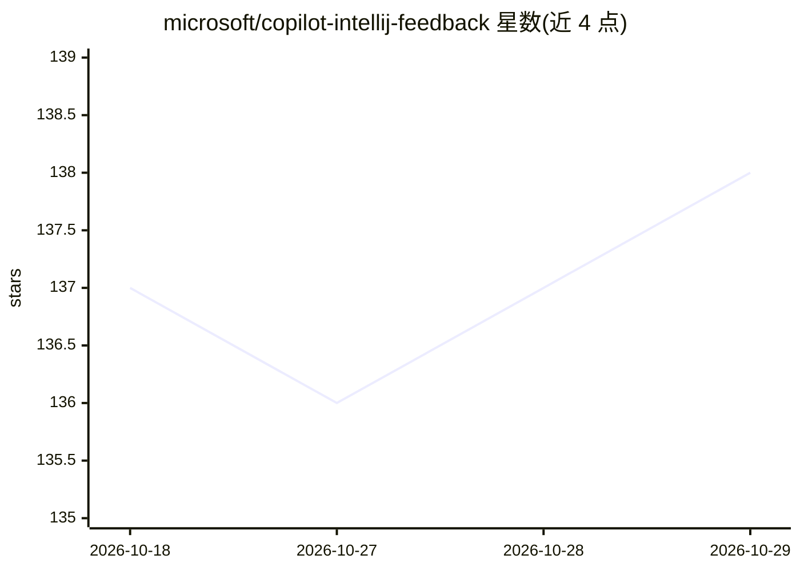

# microsoft/copilot-intellij-feedback

⭐ 138 · MIT · 推送 2026-09-24 · [GitHub](https://github.com/microsoft/copilot-intellij-feedback) · 组织维护

**GitHub Copilot JetBrains 插件的官方反馈 issue 仓库**

微软维护的 GitHub Copilot for JetBrains IDEs 插件反馈仓库，用于提交 Copilot Chat、代码补全等功能的 bug 报告与功能请求。README 提供反馈流程（搜索已有 issue、投票、新建问题）以及收集 JetBrains IDE 日志的指引以便排查问题。仓库本身不含代码，插件本体（AI 代码补全与对话助手）通过 JetBrains 市场分发，此处仅承载用户反馈。

## 筛选速览

| 维度 | 判定 | 备注 |
|---|---|---|
| AI 角色 | `ai-knowledge` | 知识聚合/清单类 |
| 许可风险 | `permissive` | MIT |
| 部署形态 | `None` |  |
| 模型依赖 | — | README 未给出锁定关系 |
| 硬件要求 | — | 无带数字的原话,不猜 |
| 安装摩擦 | `low` | 无编译、无系统依赖或容器化 |
| 成熟度 | — | 结构信号不足 |

## 能力要点

- 收集 Copilot Chat 与补全功能的 bug 与功能请求
- 提供 JetBrains IDE 日志收集指引用于排查
- 支持对已有功能请求投票

## 适用场景

- 报告 Copilot 在 JetBrains IDE 中的问题
- 为 Copilot 功能提交或投票功能请求
- 查找他人已报告问题的 workaround

## 场景标签

 · 领域:开发工具/反馈渠道

## 证据(README 行号)

> L3: GitHub Copilot Plugin for JetBrains IDEs is your AI-powered coding assistant, designed to enhance your development e
> L5: This repository is for providing feedback on the GitHub Copilot Plugin for JetBrains IDEs, including Copilot Chat, c

## 星数曲线

2026-10-18 137 → 2026-10-29 138（+1）

---
*卡片 v1 · prompt 1.4 · 生成 2026-10-22 · 置信度 mid · 依据 README sha `9d4388ff1508` · [字段定义](../../DATASET.md)*
