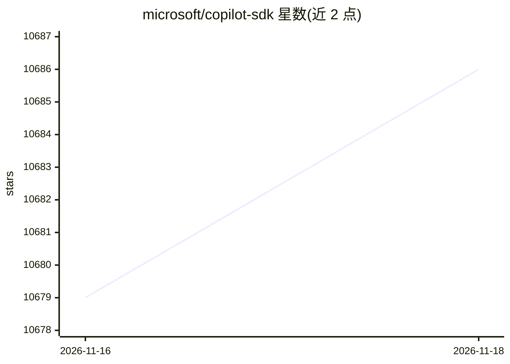

# microsoft/copilot-sdk

⭐ 10,686 · Java · MIT · 推送 2026-11-17 · [GitHub](https://github.com/microsoft/copilot-sdk) · 组织维护

**微软官方多语言 SDK：在应用中嵌入 Copilot agent 运行时**

Microsoft（GitHub）Copilot SDK 提供 Python、TypeScript、Go、.NET、Java、Rust 六种语言的客户端，通过 JSON-RPC 驱动 Copilot CLI 托管的 agent 运行时，应用可编程调用规划、工具调用、文件编辑等能力，无需自建编排。CLI 进程由 SDK 自动管理，各 SDK 也提供实验性进程内 C ABI 传输。默认暴露 Copilot CLI 第一方工具，支持自定义 agent、技能、工具与 MCP。使用需 GitHub Copilot 订阅，或配置 BYOK 自带 LLM 提供商密钥；按提示用量计费。另有社区维护的 Clojure 与 C++ 非官方 SDK。

## 筛选速览

| 维度 | 判定 | 备注 |
|---|---|---|
| AI 角色 | `ai-ecosystem` | LLM/agent 周边工具 |
| 许可风险 | `permissive` | MIT |
| 部署形态 | `library` | 以包/库形式分发 |
| 模型依赖 | — | README 未给出锁定关系 |
| 硬件要求 | — | 无带数字的原话,不猜 |
| 安装摩擦 | `medium` | 含编译或系统依赖之一 |
| 成熟度 | — | 结构信号不足 |

## 能力要点

- 六种官方语言 SDK（Python/TypeScript/Go/.NET/Java/Rust）
- 经 JSON-RPC 驱动 Copilot agent 运行时，SDK 自动管理 CLI 子进程
- BYOK 模式可用自有 LLM 提供商密钥，无需 GitHub 认证
- 支持自定义 agent、技能、工具与权限处理器

## 适用场景

- 在自己的应用中嵌入 Copilot 的 agentic 工作流
- 构建带规划与工具调用能力的可编程 agent 应用
- 通过 BYOK 用自有模型密钥运行 SDK

## 场景标签

`Agent 框架` · 领域:Agent 开发

## 证据(README 行号)

> L19: Embed Copilot's agentic workflows in your application with the GitHub Copilot SDK for Python, TypeScript, Go, .NET,
> L21: The GitHub Copilot SDK exposes the same engine behind Copilot CLI: a production-tested agent runtime you can invoke

## 星数曲线

2026-11-16 10,679 → 2026-11-18 10,686（+7）

---
*卡片 v1 · prompt 1.4 · 生成 2026-11-17 · 置信度 high · 依据 README sha `c93c2d4ec315` · [字段定义](../../DATASET.md)*
