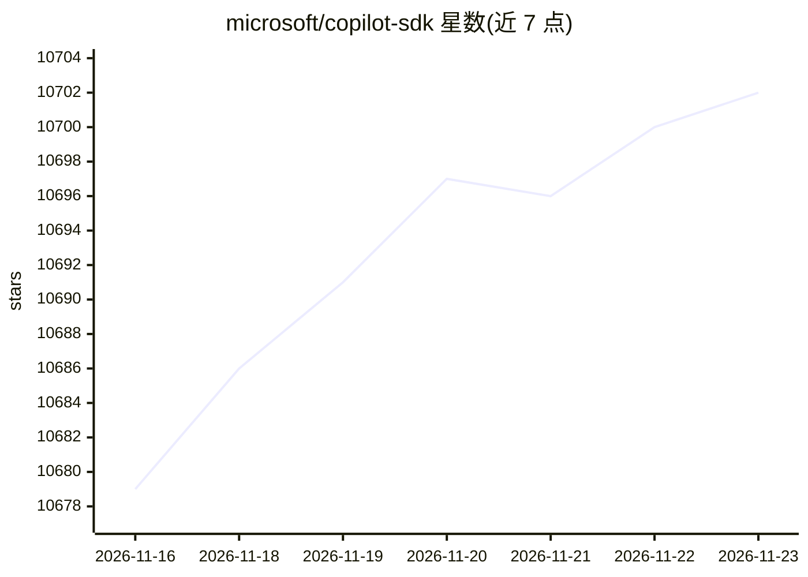

# microsoft/copilot-sdk

⭐ 10,702 · Java · MIT · 推送 2026-11-22 · [GitHub](https://github.com/microsoft/copilot-sdk) · 组织维护

**在应用中以编程方式接入 Copilot agent 运行时的多语言 SDK**

微软提供的 SDK，用于在应用中嵌入 Copilot 的 agent 工作流，覆盖 Python、TypeScript、Go、.NET、Java、Rust 六种语言。各语言 SDK 通过 protocol-4 JSON-RPC 驱动 Copilot agent 运行时（默认经 C ABI 加载原生 Rust 运行时，进程内托管），由运行时负责规划、工具调用与文件编辑，开发者定义 agent 行为。需 GitHub Copilot 订阅，或使用 BYOK 配置自有 API key；按 prompt 计入用量额度。

## 筛选速览

| 维度 | 判定 | 备注 |
|---|---|---|
| AI 角色 | `ai-ecosystem` | LLM/agent 周边工具 |
| 许可风险 | `permissive` | MIT |
| 部署形态 | `library` | 以包/库形式分发 |
| 模型依赖 | — | README 未给出锁定关系 |
| 硬件要求 | — | 无带数字的原话,不猜 |
| 安装摩擦 | `medium` | 含编译或系统依赖之一 |
| 成熟度 | — | 结构信号不足 |

## 能力要点

- 六种语言官方 SDK（Node.js/Python/Go/.NET/Rust/Java），均遵循语义化版本
- 默认进程内加载原生 Rust 运行时，亦支持子进程或独立 runtime server（TCP 多租户）接入
- BYOK 模式支持配置 OpenAI、Microsoft Foundry、Anthropic 等 API key，无需 GitHub 认证
- 支持自定义 agent、skills 与工具，工具调用由各 SDK 权限处理器审批

## 适用场景

- 在自己的应用中嵌入 Copilot 的规划与工具调用能力
- 搭建多租户独立 runtime server 供多个 SDK 客户端共用
- 用自有 LLM 提供商的 API key 通过 BYOK 运行 agent 工作流

## 场景标签

`Agent 框架` · 领域:Agent 开发

## 证据(README 行号)

> L19: Embed Copilot's agentic workflows in your application with the Microsoft Copilot SDK for Python, TypeScript, Go, .N
> L21: The Microsoft Copilot SDK exposes the same engine behind Copilot CLI: a production-tested agent runtime you can inv
> L53: All SDKs drive the Copilot agent runtime over protocol-4 JSON-RPC. The runtime is a standalone component, separate 

## 星数曲线

2026-11-16 10,679 → 2026-11-23 10,702（+23）

---
*卡片 v1 · prompt 1.4 · 生成 2026-11-22 · 置信度 high · 依据 README sha `a88895bc21e9` · [字段定义](../../DATASET.md)*
