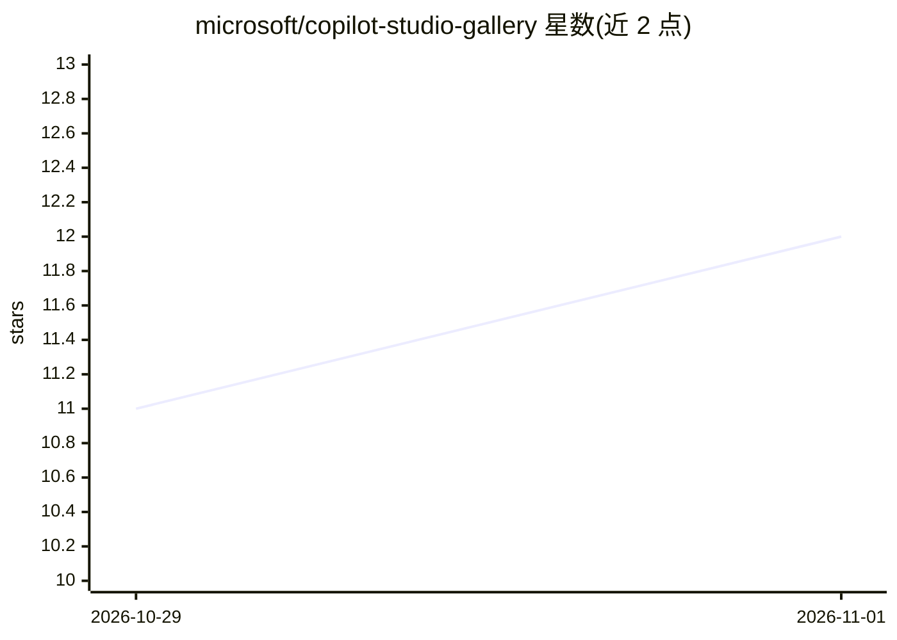

# microsoft/copilot-studio-gallery

⭐ 12 · C# · MIT · 推送 2026-10-30 · [GitHub](https://github.com/microsoft/copilot-studio-gallery) · 组织维护

**Copilot Studio 智能体与工作流方案的社区画廊站点**

微软维护的社区画廊：收录完整的 Copilot Studio 智能体与工作流解决方案，每个条目由展开的 Power Platform solution 生成，访客可在下载前查看智能体架构与保存的工作流画布。站点基于 Astro、Tailwind CSS、React Flow 构建并以 GitHub Pages 静态部署，提供按类别/标签/贡献者/组件类型的筛选、确定性重建的可下载 ZIP、贡献者目录、基于 giscus 的评论评分，以及 PR 校验流程。通过 PR 提交展开的 solution 目录即可收录。

## 筛选速览

| 维度 | 判定 | 备注 |
|---|---|---|
| AI 角色 | `ai-knowledge` | 知识聚合/清单类 |
| 许可风险 | `permissive` | MIT |
| 部署形态 | `library` | 以包/库形式分发 |
| 模型依赖 | — | README 未给出锁定关系 |
| 硬件要求 | — | 无带数字的原话,不猜 |
| 安装摩擦 | `low` | 无编译、无系统依赖或容器化 |
| 成熟度 | — | 结构信号不足 |

## 能力要点

- 条目由展开的 Power Platform solution 生成，可检查智能体组件（工具、MCP 服务器、技能）与工作流步骤
- 确定性重建的可下载 ZIP，导入前需勾选信任声明
- PR 校验：metadata、solution 结构、图表可用性、不安全文件条目
- giscus/GitHub Discussions 评论与评分，附贡献者通知工作流

## 适用场景

- 在导入前浏览并筛选现成的 Copilot Studio 智能体与工作流方案
- 查看方案的工作流画布与组件构成再决定下载
- 通过 PR 提交自己的 Power Platform solution 供社区复用

## 场景标签

`精选清单` · 领域:学习与行业

## 证据(README 行号)

> L3: A community gallery for complete **Copilot Studio agent and workflow
> L4: solutions**. Each entry is generated from an exploded Power Platform solution,
> L8: The site uses Astro, Tailwind CSS, React Flow, and static GitHub Pages deployment.

## 星数曲线

2026-10-29 11 → 2026-11-01 12（+1）

---
*卡片 v1 · prompt 1.4 · 生成 2026-11-01 · 置信度 high · 依据 README sha `06efb7450039` · [字段定义](../../DATASET.md)*
