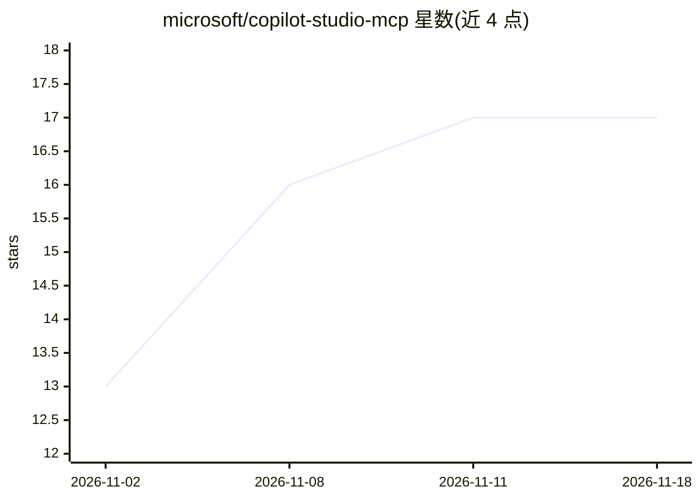

# microsoft/copilot-studio-mcp

⭐ 17 · MIT · 推送 2026-10-19 · [GitHub](https://github.com/microsoft/copilot-studio-mcp) · 组织维护

**将 Copilot Studio 工具接入 MCP 客户端的微软官方 MCP 服务器**

Microsoft 维护的 MCP 服务器，以 npm 包 @microsoft/copilot-studio-mcp 发布，通过 npx 在 MCP 兼容客户端（GitHub Copilot CLI、VS Code 等）中启动，经 stdio 通信并连接到 Copilot Studio 托管服务。用户以 Microsoft 工作账号登录并选择环境后，可使用 discover_resources、manage_agents、manage_workflows、get_consumption 等工具，覆盖 agent 与自动化生命周期的创建、配置、测试、部署与监控。访问受身份、环境权限与组织策略约束；需 Node.js 22.18+。

## 筛选速览

| 维度 | 判定 | 备注 |
|---|---|---|
| AI 角色 | `ai-ecosystem` | LLM/agent 周边工具 |
| 许可风险 | `permissive` | MIT |
| 部署形态 | `library` | 以包/库形式分发 |
| 模型依赖 | — | README 未给出锁定关系 |
| 硬件要求 | — | 无带数字的原话,不猜 |
| 安装摩擦 | `low` | 无编译、无系统依赖或容器化 |
| 成熟度 | — | 结构信号不足 |

## 能力要点

- npm 包形式发布，客户端用 npx 启动，通过 stdio 通信
- 提供 discover_resources/manage_agents/manage_workflows/get_consumption 等工具
- 工具操作经 action 与 parameters 暴露，可用 describe_actions 查看契约与副作用
- 支持 GitHub MCP Registry 与官方 MCP Registry 发现，含 FedRAMP High 合规说明

## 适用场景

- 在 VS Code 或 GitHub Copilot CLI 中管理 Copilot Studio 的 agent 与工作流
- 查询 agent/工作流的信用消耗与环境容量
- 发现连接器操作、schema 与可附加资源

## 场景标签

 · 领域:开发者工具/Agent 基础设施

## 证据(README 行号)

> L3: Microsoft Copilot Studio MCP brings Copilot Studio tools into Model Context
> L16: Your client launches this package with `npx`. The server connects to Copilot

## 星数曲线

2026-11-02 13 → 2026-11-18 17（+4）

---
*卡片 v1 · prompt 1.4 · 生成 2026-11-18 · 置信度 high · 依据 README sha `8fc4db0dc6c8` · [字段定义](../../DATASET.md)*
