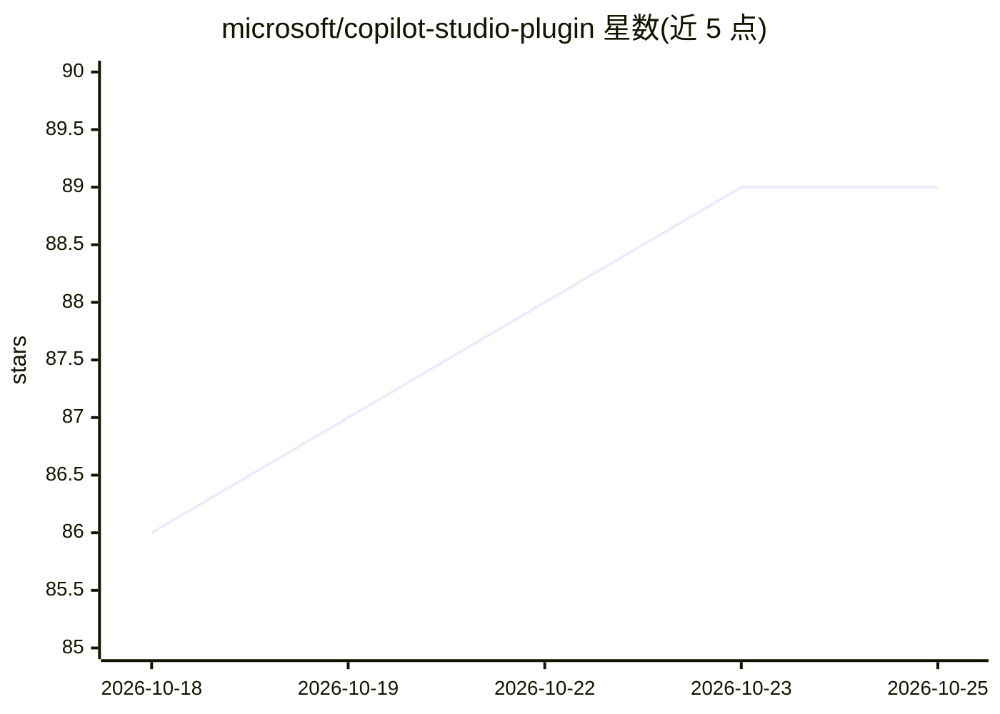

# microsoft/copilot-studio-plugin

⭐ 89 · JavaScript · MIT · 推送 2026-10-07 · [GitHub](https://github.com/microsoft/copilot-studio-plugin) · 组织维护

**Copilot Studio 插件：创建、编辑、验证与迁移 GHCP Harness agent**

微软维护的 GitHub Copilot 插件仓库，skills-for-copilot-studio 的后继项目：为 Copilot Studio GHCP Harness 提供插件与配套技能，用于创建、编辑、验证 agent，以及将 Classic Harness agent 迁移到 GHCP Harness。依赖 Power Platform CLI（pac）2.9.3 及以上版本。README 声明插件仍在开发中，仅通过 GitHub Issues 提供支持，YAML schema 可能随时变更，生成的 YAML 需人工审查后再推送。

## 筛选速览

| 维度 | 判定 | 备注 |
|---|---|---|
| AI 角色 | `ai-ecosystem` | LLM/agent 周边工具 |
| 许可风险 | `permissive` | MIT |
| 部署形态 | `None` |  |
| 模型依赖 | — | README 未给出锁定关系 |
| 硬件要求 | — | 无带数字的原话,不猜 |
| 安装摩擦 | `low` | 无编译、无系统依赖或容器化 |
| 成熟度 | `idea` | |

## 能力要点

- 支持 Copilot Studio Classic Harness 到 GHCP Harness 的 agent 迁移
- 提供创建、编辑、验证 agent 的插件能力
- 依赖 Power Platform CLI (pac) 2.9.3+

## 适用场景

- 将现有 Copilot Studio Classic agent 迁移到 GHCP Harness
- 在 Copilot 环境中创建和验证 agent 的 YAML 配置

## 场景标签

`Agent 框架` · 领域:Agent 开发

## 证据(README 行号)

> L3: This repository is the successor to skills-for-copilot-studio. It contains a plugin and supporting skills for Micros
> L5: This plugin requires the Power Platform CLI (`pac`), specifically version 2.9.3 or higher. Install the latest versio

## 星数曲线

2026-10-18 86 → 2026-10-25 89（+3）

---
*卡片 v1 · prompt 1.4 · 生成 2026-10-23 · 置信度 high · 依据 README sha `8b6483219b58` · [字段定义](../../DATASET.md)*
