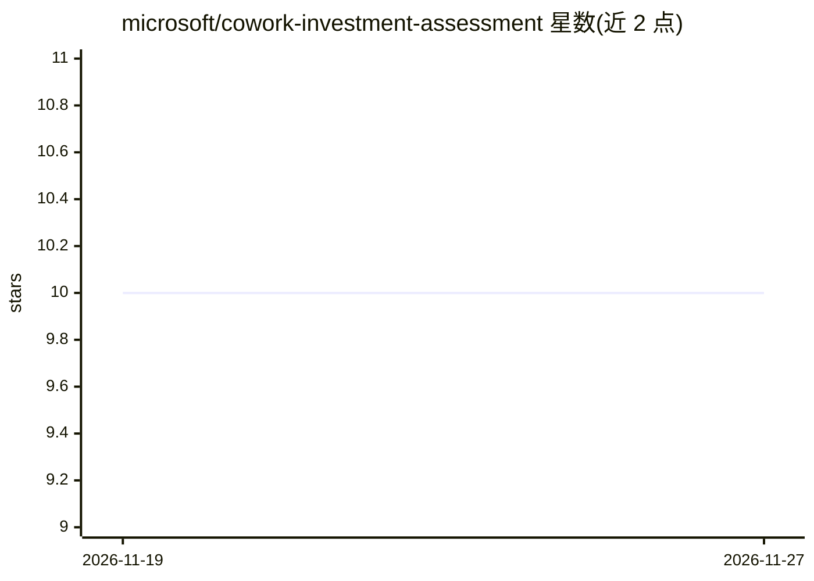

# microsoft/cowork-investment-assessment

⭐ 10 · HTML · MIT · 推送 2026-10-08 · [GitHub](https://github.com/microsoft/cowork-investment-assessment) · [官网](https://aka.ms/CoworkInvestmentAdvisor) · 组织维护

**评估 M365 Copilot Cowork 投资回报的评估工具包**

面向 Microsoft 365 Copilot 管理与采购决策的工具包：读取 Work IQ 信号（邮件、会议、文档、聊天、协作模式），识别用户画像、发现适合 Copilot Cowork 编排的工作流、评估复杂度、估算 credit 消耗（PAYGO 与 P3）并计算 ROI。内置五条准入标准过滤工作流，纯信息型任务自动排除并改导向 Copilot Chat/Pages/Scheduled Prompts。同一 agent 提供 Prompt、Agent Builder、预构建 Agent 三种交付格式。与 Customer Cowork Estimator 配合，后者承担核心计算。

## 筛选速览

| 维度 | 判定 | 备注 |
|---|---|---|
| AI 角色 | `ai-native` | 本体是模型或模型工具 |
| 许可风险 | `permissive` | MIT |
| 部署形态 | `None` |  |
| 模型依赖 | — | README 未给出锁定关系 |
| 硬件要求 | — | 无带数字的原话,不猜 |
| 安装摩擦 | `low` | 无编译、无系统依赖或容器化 |
| 成熟度 | — | 结构信号不足 |

## 能力要点

- 基于 Work IQ 真实工作模式识别用户画像并推荐前 3 个工作流
- 估算 credit 消耗、PAYGO/P3 成本与 ROI
- 五条准入标准强制筛选可编排工作流，信息型任务自动排除
- 三种交付格式：Copilot Chat 提示词、Agent Builder、Admin Centre 全组织部署

## 适用场景

- 采购前评估 M365 Copilot Cowork 对本组织的适配度
- 为团队找出值得用 Cowork 编排的工作流
- 向管理层输出具备执行建议的 ROI 评估报告

## 场景标签

 · 领域:企业 IT/Copilot 投资评估

## 证据(README 行号)

> L3: A toolkit for evaluating whether Microsoft 365 Copilot Cowork is a good fit for a user's workload. It analyses Work 
> L5: This agent is designed to work alongside the Customer Cowork Estimator. The estimator handles the core maths once yo
> L42: |**Prompt**|Any user with a Copilot licence|Individual|You want to run the assessment immediately by pasting a prom

## 星数曲线

2026-11-19 10 → 2026-11-27 10（+0）

---
*卡片 v1 · prompt 1.4 · 生成 2026-11-19 · 置信度 high · 依据 README sha `fe0255cd1a76` · [字段定义](../../DATASET.md)*
