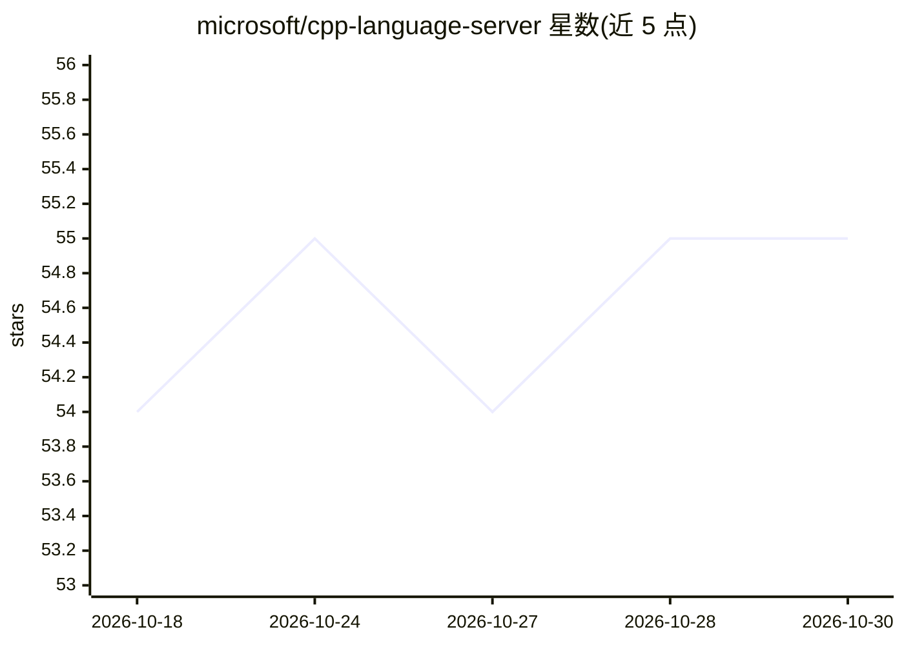

# microsoft/cpp-language-server

⭐ 55 · MIT · 推送 2026-10-23 · [GitHub](https://github.com/microsoft/cpp-language-server) · 组织维护

**微软 C++ 语言服务器：为 GitHub Copilot CLI 提供 C++ 代码智能**

将 Visual Studio 与 VS Code 中使用的 C++ 代码智能（符号搜索、语义导航等 LSP 能力）提供给 GitHub Copilot CLI，支持 Windows、macOS 和 Linux。通过 copilot-plugins 市场以插件形式安装，捆绑语言服务器并自动更新；首次需运行 npx 命令接受 EULA 并登录 GitHub，要求有效的 GitHub Copilot 订阅。项目需提供 compile_commands.json（可由 CMake/MSBuild 生成）。README 声明当前处于 preview 阶段，并包含微软数据收集（遥测）条款。

## 筛选速览

| 维度 | 判定 | 备注 |
|---|---|---|
| AI 角色 | `ai-ecosystem` | LLM/agent 周边工具 |
| 许可风险 | `permissive` | MIT |
| 部署形态 | `library` | 以包/库形式分发 |
| 模型依赖 | — | README 未给出锁定关系 |
| 硬件要求 | — | 无带数字的原话,不猜 |
| 安装摩擦 | `medium` | 含编译或系统依赖之一 |
| 成熟度 | `idea` | |

## 能力要点

- 为 GitHub Copilot CLI 提供符号搜索与语义导航等 LSP 功能
- 以 copilot-plugins 市场插件形式安装并自动更新
- 跨 Windows、macOS、Linux 三平台
- 支持通过 CMake/MSBuild 生成 compile_commands.json 配置项目

## 适用场景

- 在 GitHub Copilot CLI 中对 C++ 代码库做语义导航与符号搜索
- 让 Copilot CLI agent 调用 LSP 工具理解 C++ 工程
- 为已有 CMake/MSBuild C++ 项目接入代码智能

## 场景标签

 · 领域:开发工具/代码智能

## 证据(README 行号)

> L7: **Microsoft C++ Language Server** brings the same C++ code intelligence used in Visual Studio and VS Code to GitHub 
> L30: 5. Within GitHub Copilot CLI, run `/lsp show`. You should see a "cpp" server running.

## 星数曲线

2026-10-18 54 → 2026-10-30 55（+1）

---
*卡片 v1 · prompt 1.4 · 生成 2026-10-24 · 置信度 high · 依据 README sha `ce4a9b93e75e` · [字段定义](../../DATASET.md)*
