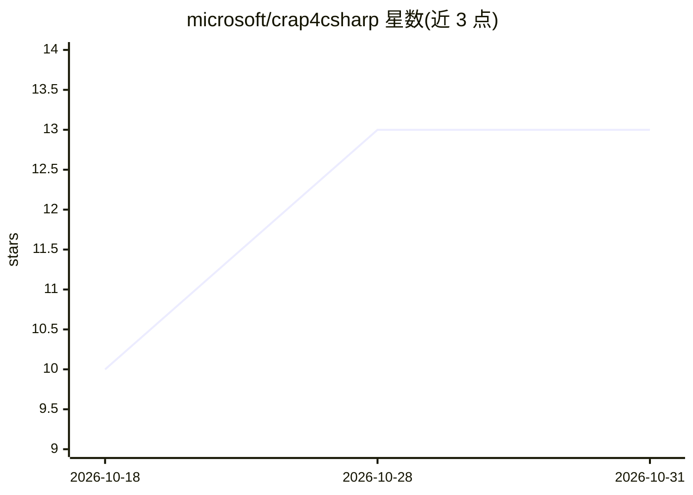

# microsoft/crap4csharp

⭐ 13 · C# · CC0-1.0 · 推送 2026-09-09 · [GitHub](https://github.com/microsoft/crap4csharp) · 组织维护

**C# 项目的 CRAP 代码质量度量工具（复杂度×覆盖率）**

crap4java 的 C# 独立移植版，计算 C# 代码成员（方法、属性访问器、运算符、终结器等）的圈复杂度，结合 Coverlet/Cobertura 单元测试覆盖率，按公式 CRAP=CC²×(1-coverage)³+CC 输出报告。每次运行自动清理并重跑覆盖率，解析单一 owning .csproj 及其 .Tests 测试项目；无匹配项目或文件跨项目时 fail fast 退出。异步/迭代器与 lambda 覆盖率回算到源方法；CRAP 阈值超 8.0 时 exit 2。通过 dotnet build/run 从源码运行。

## 筛选速览

| 维度 | 判定 | 备注 |
|---|---|---|
| AI 角色 | `ai-enhanced` | 去掉 AI 部分产品仍成立 |
| 许可风险 | `viral` | CC0-1.0 |
| 部署形态 | `None` |  |
| 模型依赖 | — | README 未给出锁定关系 |
| 硬件要求 | — | 无带数字的原话,不猜 |
| 安装摩擦 | `medium` | 含编译或系统依赖之一 |
| 成熟度 | — | 结构信号不足 |

## 能力要点

- 按成员计算 CRAP = CC²×(1-coverage)³ + CC 并输出排序报告
- 自动解析 owning .csproj 与 .Tests/.UnitTests 项目并运行 Coverlet 覆盖率
- 异步/迭代器/lambda/局部函数的覆盖率回算到源方法
- CRAP > 8.0 触发 exit 2 阈值门禁

## 适用场景

- 在 CI 中检测高复杂度且低覆盖的 C# 方法
- 增量分析改动文件的 CRAP 分数
- 为重构与补测试排定优先级

## 场景标签

 · 领域:软件开发工具/代码质量

## 证据(README 行号)

> L74: ## Test policy (agentic dev loop)

## 星数曲线

2026-10-18 10 → 2026-10-31 13（+3）

---
*卡片 v1 · prompt 1.4 · 生成 2026-10-31 · 置信度 low · 依据 README sha `48f8b632e240` · [字段定义](../../DATASET.md)*
