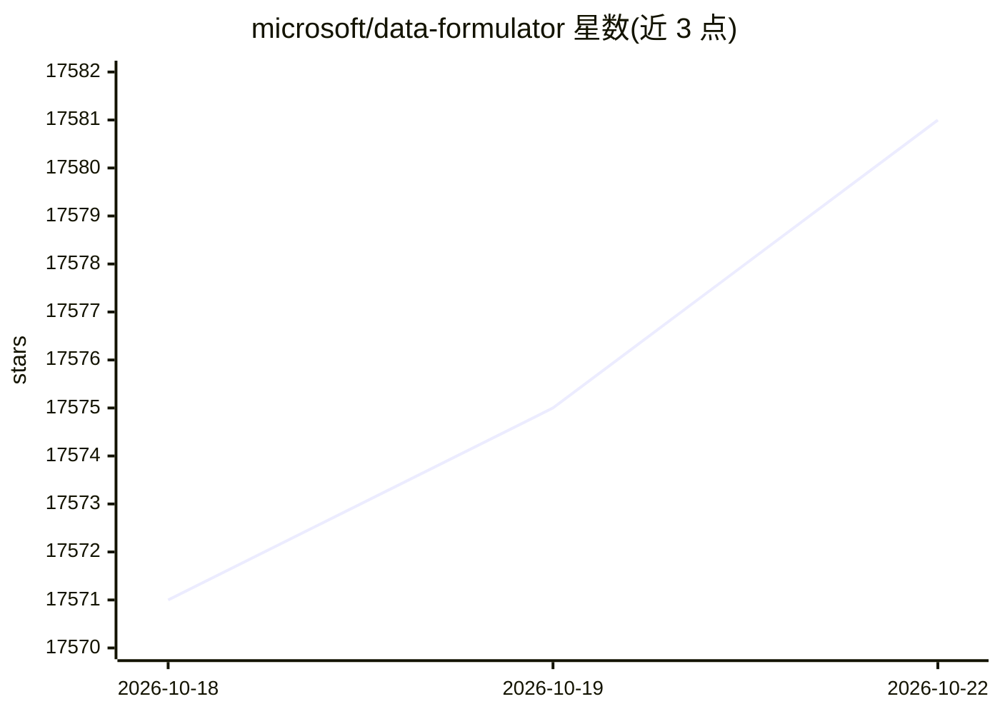

# microsoft/data-formulator

⭐ 17,588 · Python · MIT · 推送 2026-10-22 · [GitHub](https://github.com/microsoft/data-formulator) · [官网](https://data-formulator.ai/) · 组织维护

**给分析师的 AI 数据探索工作台：连接、分析并可视化数据**

微软研究院出品的交互式数据分析系统，将 UI 交互与自然语言结合：数据连接器统一接入文件、本地文件夹、数据库与 Databricks 等平台并维护数据间关系记忆；Data Thread 支持分支提问、对比分析路径；可视化由 Flint 图表语言驱动，支持 30+ 图表类型、风格微调 agent 与报告分享。支持 CSV/TSV/Excel/JSON/截图/文本等输入。提供桌面版（Windows/macOS，未签名）与 uv/pip/Docker 运行方式，浏览器访问 localhost:5567，UI 支持英文/中文。

## 筛选速览

| 维度 | 判定 | 备注 |
|---|---|---|
| AI 角色 | `ai-native` | 本体是模型或模型工具 |
| 许可风险 | `permissive` | MIT |
| 部署形态 | `desktop` | 安装包/桌面程序 |
| 模型依赖 | — | README 未给出锁定关系 |
| 硬件要求 | — | 无带数字的原话,不猜 |
| 安装摩擦 | `low` | 无编译、无系统依赖或容器化 |
| 成熟度 | — | 结构信号不足 |

## 动量与使用信号

- 维护:`active` — 距上次 push 1.3 天,年发版 7,36 位贡献者
- 涨星:近 1 天 **+5**(自 20261016 起算)
- 安装:pypi 包 `data_formulator` 月下载 1,032
- 平台:— · 协议:OLLAMA

## 能力要点

- 数据连接器统一接入文件、数据库与数据平台，并维护数据关系记忆
- Data Thread 分支式分析：从任意步骤分支探索替代路径
- 基于 Flint 图表语言的 30+ 图表类型与风格微调 agent
- 通过 LiteLLM 支持 OpenAI、Azure、Ollama、Anthropic 等模型

## 适用场景

- 用自然语言探索 CSV、Excel 或数据库中的数据并生成图表
- 多数据源场景下管理数据间关系并分支比较分析思路
- 把分析过程整理成报告分享给团队

## 场景标签

`数据分析` · 领域:效率与自动化

## 证据(README 行号)

> L73: **Data Formulator** is a Microsoft Research project for data exploration with visualizations powered by AI agents. 
> L29: 1. **Data connectors** give agents a common way to connect to different data
> L65: - **Model Support**: OpenAI, Azure, Ollama, Anthropic via LiteLLM (feedback)

## 星数曲线

2026-10-18 17,571 → 2026-10-22 17,581（+10）

---
*卡片 v1 · prompt 1.4 · 生成 2026-10-18 · 置信度 high · 依据 README sha `ccb093e0630a` · [字段定义](../../DATASET.md)*
