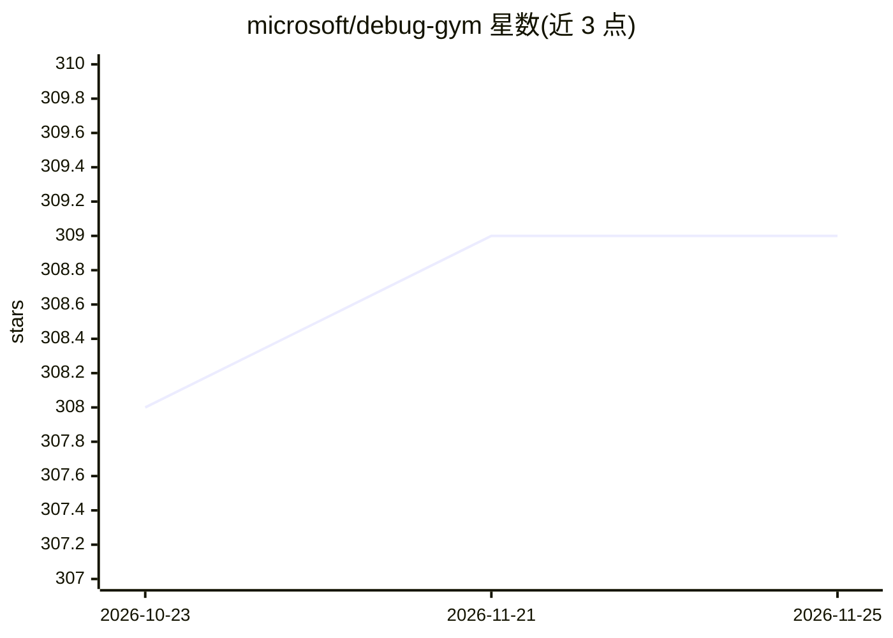

# microsoft/debug-gym

⭐ 309 · Python · MIT · 推送 2026-11-23 · [GitHub](https://github.com/microsoft/debug-gym) · [官网](https://aka.ms/debug-gym/) · 组织维护

**面向 LLM agent 的文本式交互调试环境框架**

针对 Python 程序调试的文本式交互环境：提供 Gymnasium 范式的仿真环境，agent 通过 bash、pdb、eval、edit、grep 等工具迭代探查代码仓库并生成补丁，再由测试用例验证。内置 froggy_agent 等 LLM agent 示例，接入 OpenAI、Azure OpenAI、Hugging Face/vLLM、Anthropic 后端，支持 Docker/Kubernetes 终端与 aider、swebench 等基准集成。主要面向研究者构建与评测调试类 agent；pdb 工具仅在 Linux 可用。

## 筛选速览

| 维度 | 判定 | 备注 |
|---|---|---|
| AI 角色 | `ai-ecosystem` | LLM/agent 周边工具 |
| 许可风险 | `permissive` | MIT |
| 部署形态 | `library` | 以包/库形式分发 |
| 模型依赖 | local-ok | 支持本地模型 |
| 硬件要求 | — | 无带数字的原话,不猜 |
| 安装摩擦 | `low` | 无编译、无系统依赖或容器化 |
| 成熟度 | — | 结构信号不足 |

## 能力要点

- pdb、bash、eval、edit 等可动态导入与自定义的工具集
- 提供 froggy_agent 等示例 agent 与 swebench-debug 定制基准
- 支持 OpenAI/Azure OpenAI/Hugging Face(vLLM)/Anthropic 多种 LLM 后端
- Docker 与 Kubernetes 终端后端及超时机制

## 适用场景

- 构建并评测基于 LLM 的交互式调试 agent
- 在 swebench、swesmith 等基准上运行调试任务实验
- 通过自定义工具扩展 agent 的动作与观察空间

## 场景标签

`编码 Agent` `模型评测` `Agent 框架` · 领域:Agent 开发

## 证据(README 行号)

> L3: `debug-gym` is a text-based interactive debugging framework, designed for debugging Python programs.
> L74: `debug_gym.gym` is a simulation environment. Given a code repository, an agent can iteratively interact with a set 
> L78: `debug_gym.llms` are the different LLM backends that can be used to instantiate agents. Currently, we support OpenA

## 星数曲线

2026-10-23 308 → 2026-11-25 309（+1）

---
*卡片 v1 · prompt 1.4 · 生成 2026-11-25 · 置信度 high · 依据 README sha `4d23691ddbe2` · [字段定义](../../DATASET.md)*
