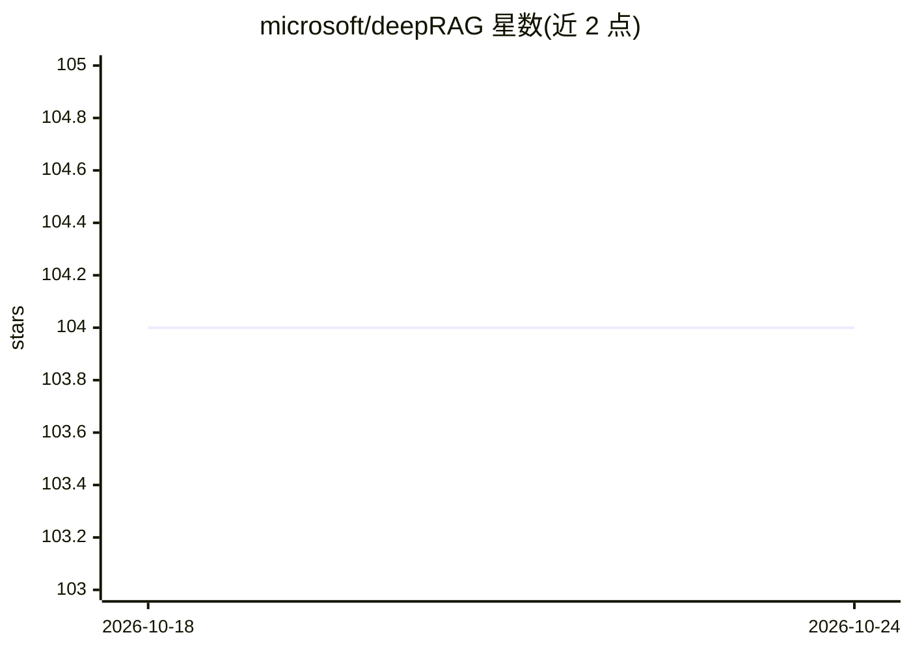

# microsoft/deepRAG

⭐ 104 · Python · MIT · 推送 2026-10-21 · [GitHub](https://github.com/microsoft/deepRAG) · 组织维护

**扩展经典向量检索 RAG 的实验性检索增强项目**

deepRAG 项目在经典基于向量数据库的检索之外，引入其他搜索技术以扩展 RAG 结果集：初期通过图数据库回答与内容摘要相关、而非直接对应内容片段的查询。架构说明位于 ARCHITECTURE.MD。README 仅给出以 poetry 安装并选择 poetry 缓存中解释器的运行方式，其余为代码，功能细节与支持的数据源需查阅架构文档确认，自述使用实验性技术混合方案。

## 筛选速览

| 维度 | 判定 | 备注 |
|---|---|---|
| AI 角色 | `ai-ecosystem` | LLM/agent 周边工具 |
| 许可风险 | `permissive` | MIT |
| 部署形态 | `None` |  |
| 模型依赖 | — | README 未给出锁定关系 |
| 硬件要求 | — | 无带数字的原话,不猜 |
| 安装摩擦 | `low` | 无编译、无系统依赖或容器化 |
| 成熟度 | `idea` | |

## 能力要点

- 在向量检索 RAG 之上引入图数据库扩展检索结果
- 面向与内容摘要相关而非片段直接匹配的查询
- 架构设计见 ARCHITECTURE.MD

## 适用场景

- RAG 检索结果不足时尝试图数据库扩展召回
- 研究向量检索之外的混合检索方案

## 场景标签

`RAG` · 领域:知识与检索

## 证据(README 行号)

> L3: The deepRAG project seeks to extend classic retrieval using vector databases to optional utilize other search techno
> L4: This will initially be done by utilizing graph databases to help answer queries related to content summaries that ar

## 星数曲线

2026-10-18 104 → 2026-10-24 104（+0）

---
*卡片 v1 · prompt 1.4 · 生成 2026-10-23 · 置信度 low · 依据 README sha `3344962677c7` · [字段定义](../../DATASET.md)*
