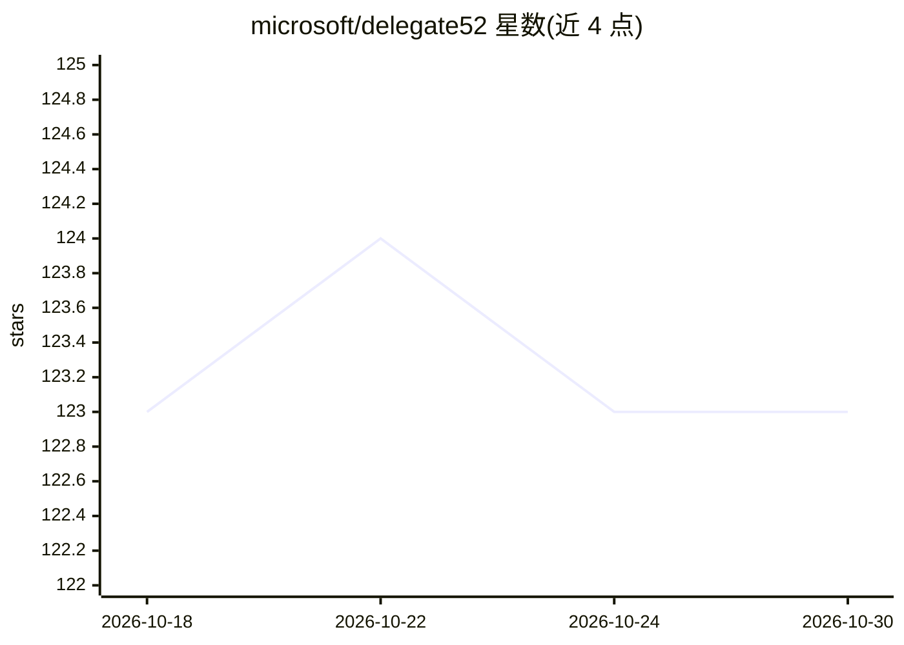

# microsoft/delegate52

⭐ 123 · Python · MIT · 推送 2026-06-12 · [GitHub](https://github.com/microsoft/delegate52) · [官网](https://arxiv.org/abs/2604.15597) · 组织维护

**评测 LLM 长程文档代编辑保真度的基准（52 领域）**

随论文 "LLMs Corrupt Your Documents When You Delegate" 发布的基准代码：模拟 LLM 代知识工作者编辑专业文档的长程委托工作流。核心机制是往返接力——LLM 先做结构编辑（forward），再做撤销编辑（backward），链式串联多次往返后用 52 个领域专用评估器比对恢复文档与原文，以 RS@k 度量文档保真度。提供 OpenAI/Azure 封装与 agentic 工具调用两种生成路径，数据集（234 环境/48 领域）托管于 Hugging Face，运行需自带 LLM API 访问并产生真实费用，仅设计并测试于英文。

## 筛选速览

| 维度 | 判定 | 备注 |
|---|---|---|
| AI 角色 | `ai-ecosystem` | LLM/agent 周边工具 |
| 许可风险 | `permissive` | MIT |
| 部署形态 | `library` | 以包/库形式分发 |
| 模型依赖 | locked-api |  |
| 硬件要求 | — | 无带数字的原话,不猜 |
| 安装摩擦 | `low` | 无编译、无系统依赖或容器化 |
| 成熟度 | — | 结构信号不足 |

## 能力要点

- 52 个专业领域的往返接力（round-trip relay）编辑模拟
- RS@k 指标经领域专用评估器度量文档保真度
- 提供 run_relay.py 接力实验与 run_single.py 单次编辑 QA 脚本
- 含 agentic harness：LLM 通过工具（读写删文件、运行 Python）多轮编辑

## 适用场景

- 复现论文中 19 个 LLM 的长程编辑评测结果
- 测试新 LLM 在专业文档编辑中的保真表现
- 扩展新领域解析器与评估器构建自定义基准

## 场景标签

`模型评测` · 领域:评测与运维

## 证据(README 行号)

> L7: DELEGATE-52 is a benchmark for evaluating LLMs on long-horizon delegated document editing across 52 professional dom
> L30: We evaluated 19 LLMs from six families (OpenAI, Anthropic, Google, Mistral, xAI, Moonshot) using the Reconstruction

## 星数曲线

2026-10-18 123 → 2026-10-30 123（+0）

---
*卡片 v1 · prompt 1.4 · 生成 2026-10-23 · 置信度 high · 依据 README sha `6f572dc50304` · [字段定义](../../DATASET.md)*
