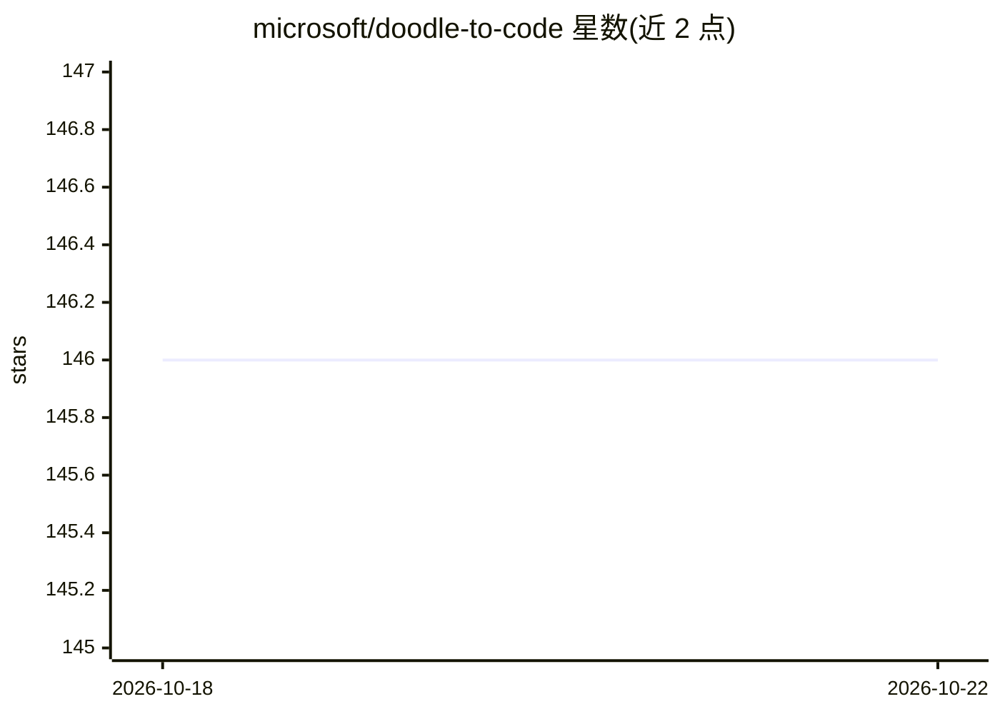

# microsoft/doodle-to-code

⭐ 146 · TypeScript · CC-BY-4.0 · 推送 2025-11-25 · [GitHub](https://github.com/microsoft/doodle-to-code) · 组织维护

**面向初学者的生成式 AI 与 Agent 视频教程与实践系列**

通过手绘涂鸦与简明讲解介绍生成式 AI、Agentic AI、MCP、RAG 等概念的入门教程系列，每期内容配套视频、概念图解与动手编码项目，最终构建带对话 AI 的应用。实践环境依赖 Visual Studio Code、GitHub Copilot 许可证与 Azure 账号（Azure AI Foundry/Azure OpenAI），部分练习使用 Microsoft Teams 机器人示例。内容分两季：2025 年 Agentic AI 季与 2023-2024 生成式 AI 季，视频发布于 YouTube。

## 筛选速览

| 维度 | 判定 | 备注 |
|---|---|---|
| AI 角色 | `ai-knowledge` | 知识聚合/清单类 |
| 许可风险 | `viral` | CC-BY-4.0 |
| 部署形态 | `None` |  |
| 模型依赖 | — | README 未给出锁定关系 |
| 硬件要求 | — | 无带数字的原话,不猜 |
| 安装摩擦 | `low` | 无编译、无系统依赖或容器化 |
| 成熟度 | — | 结构信号不足 |

## 能力要点

- 每期内容配套视频、概念涂鸦与动手编码项目
- 第二季覆盖 Agentic AI、Copilot Agent Mode、MCP、多模态与多模型
- 第一季覆盖提示工程、Teams 聊天机器人、Assistants API、RAG 与部署

## 适用场景

- 初学者通过图解与视频入门生成式 AI 与 Agent 概念
- 跟随动手项目构建 Teams 对话机器人与 RAG 助手
- 了解 GitHub Copilot Agent Mode 与 MCP 的实际用法

## 场景标签

 · 领域:AI 教育/知识科普

## 证据(README 行号)

> L1: # Doodle to Code: A Practical guide to getting started with Generative AI & Agents
> L3: Learn the fundamentals of Generative AI, agentic AI, agents, and related technologies from doodles and apply the kno

## 星数曲线

2026-10-18 146 → 2026-10-22 146（+0）

---
*卡片 v1 · prompt 1.4 · 生成 2026-10-22 · 置信度 high · 依据 README sha `174aa5336fac` · [字段定义](../../DATASET.md)*
