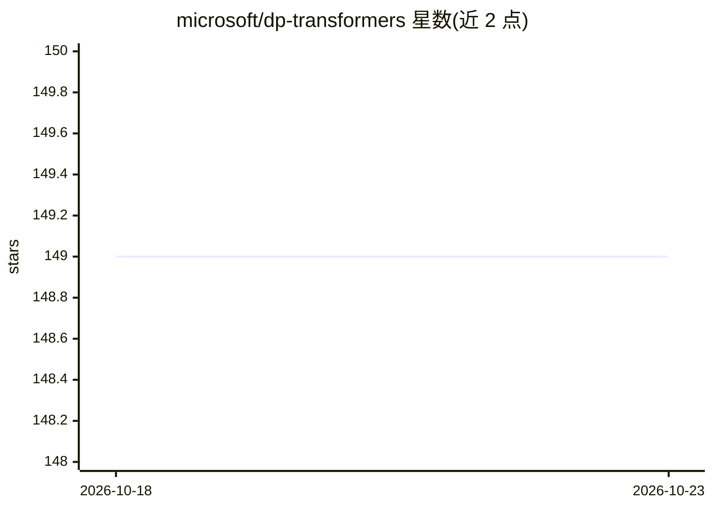

# microsoft/dp-transformers

⭐ 149 · Python · MIT · 推送 2026-10-09 · [GitHub](https://github.com/microsoft/dp-transformers) · 组织维护

**面向研究者的差分隐私 Transformer 训练扩展库**

基于 HuggingFace Transformers 与 Opacus 构建的 Python 扩展库，用于以差分隐私方式微调/训练 Transformer 模型。提供接入 PrivacyEngine 的 Trainer 回调、适配 Opacus 的自定义 DataCollator（修正 position_ids 复制导致的 batch size 推断问题）以及 GPT2 Conv1D 层的梯度采样器实现，并给出 DP 训练超参建议。README 声明本仓库面向研究项目与原型，未经适用于隐私关键系统的详细审查流程。通过 pip 从源码安装，示例需自建 conda 环境运行。

## 筛选速览

| 维度 | 判定 | 备注 |
|---|---|---|
| AI 角色 | `ai-ecosystem` | LLM/agent 周边工具 |
| 许可风险 | `permissive` | MIT |
| 部署形态 | `library` | 以包/库形式分发 |
| 模型依赖 | — | README 未给出锁定关系 |
| 硬件要求 | — | 无带数字的原话,不猜 |
| 安装摩擦 | `low` | 无编译、无系统依赖或容器化 |
| 成熟度 | `idea` | |

## 能力要点

- Trainer 回调自动将 PrivacyEngine 接入优化器
- 自定义 DataCollator 使 position_ids 张量与 Opacus 兼容
- 为 GPT2 的 Conv1D 层提供可注册的 grad sampler
- 包含 DP 训练超参数与部署 PRNG 选择的一般性建议

## 适用场景

- 研究项目中以差分隐私微调 GPT2 等 Transformer 模型
- 在 HuggingFace Trainer 流程中接入 Opacus 隐私引擎
- 复现 sample-level DP 的 NLG 微调端到端示例

## 场景标签

`微调` · 领域:训练与推理

## 证据(README 行号)

> L33: ## 🤗 Transformers with Opacus
> L65: In this repo we provide an implementation for handling this type of layer.

## 星数曲线

2026-10-18 149 → 2026-10-23 149（+0）

---
*卡片 v1 · prompt 1.4 · 生成 2026-10-22 · 置信度 mid · 依据 README sha `80c822bc17f8` · [字段定义](../../DATASET.md)*
