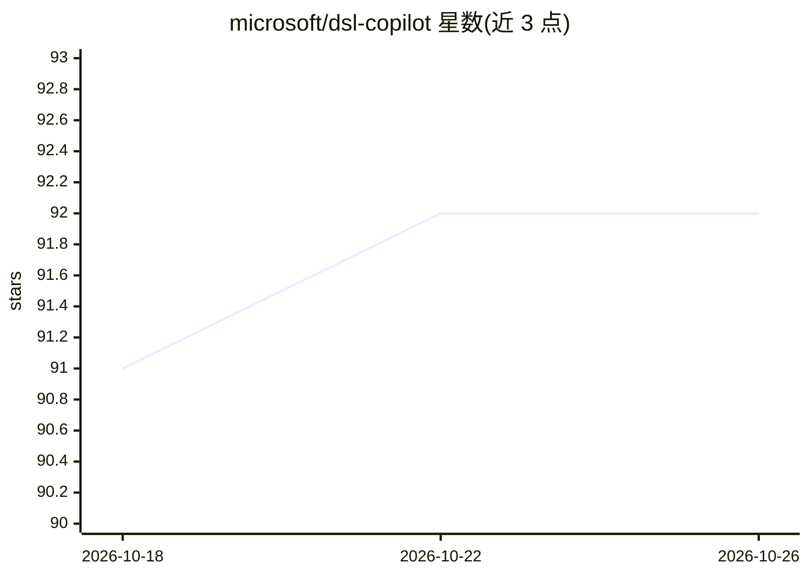

# microsoft/dsl-copilot

⭐ 92 · C# · MIT · 推送 2026-08-24 · [GitHub](https://github.com/microsoft/dsl-copilot) · 组织维护

**面向专有 DSL 代码生成的 LLM 聊天应用方案**

微软发布的 DSL Copilot 方案：针对专有领域语言（DSL）缺乏公开训练数据导致 LLM 幻觉的问题，提供一整套流程——在系统提示中加入语法文件（TextMate/ANTLR 解析）与文档化示例锚定语言上下文，通过 Azure Function 分块文档并生成嵌入存入 AI Search，Semantic Kernel 编排代码生成 Agent、编译校验重试、Linting 与用户反馈回路，并附带微调数据管道生成 JSONL 以减少 token 用量。给需要在自有 DSL 上构建代码问答/生成应用的开发者使用。README 未给出安装运行命令。

## 筛选速览

| 维度 | 判定 | 备注 |
|---|---|---|
| AI 角色 | `ai-native` | 本体是模型或模型工具 |
| 许可风险 | `permissive` | MIT |
| 部署形态 | `None` |  |
| 模型依赖 | — | README 未给出锁定关系 |
| 硬件要求 | — | 无带数字的原话,不猜 |
| 安装摩擦 | `low` | 无编译、无系统依赖或容器化 |
| 成熟度 | — | 结构信号不足 |

## 能力要点

- 语法文件+本地/索引示例注入系统提示以锚定 LLM 于 DSL 上下文
- 编译校验失败回传错误并重试的代码生成流水线
- Azure 存储触发分块、嵌入生成与 AI Search 向量检索架构
- 迭代提示生成 JSONL 的微调数据管道，微调后可移除语法文件

## 适用场景

- 为企业专有 DSL 搭建代码生成与问答聊天应用
- 通过编译器反馈回路校验并修正 LLM 生成的 DSL 代码
- 构造微调数据集以降低 DSL 代码生成的 token 消耗

## 场景标签

`代码生成` `RAG` `微调` · 领域:编码与开发

## 证据(README 行号)

> L20: 1. Code Generation Agent - Initial prompt to generate code in the DSL based language. This agent utilizes the gramm
> L27: To limit the number of tokens required in the UI and to allow for the removal of the grammar file, an additional se

## 星数曲线

2026-10-18 91 → 2026-10-26 92（+1）

---
*卡片 v1 · prompt 1.4 · 生成 2026-10-23 · 置信度 mid · 依据 README sha `3d33768649ff` · [字段定义](../../DATASET.md)*
