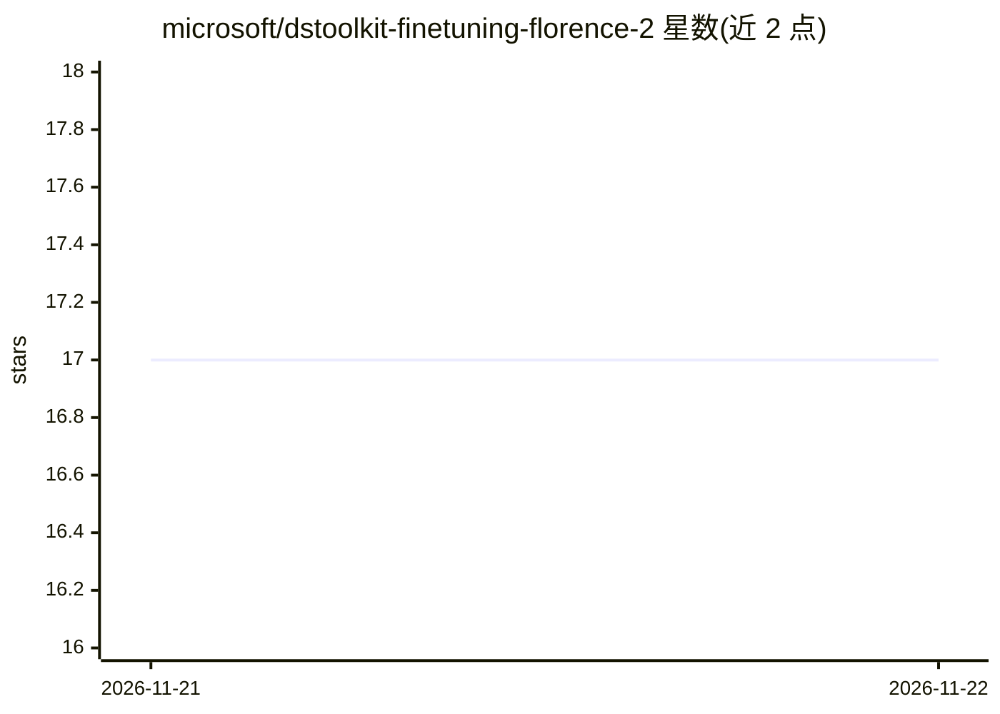

# microsoft/dstoolkit-finetuning-florence-2

⭐ 17 · Jupyter Notebook · MIT · 推送 2026-11-20 · [GitHub](https://github.com/microsoft/dstoolkit-finetuning-florence-2) · 组织维护

**教开发者微调 Florence-2 视觉模型的教程加速器**

微软 Data Science Toolkit 下的教程型项目，以一系列 notebook 展示 Florence-2 视觉基础模型的通用用法与限制，并给出一个在简单示例上做目标检测微调的完整流程；用户可按说明修改 notebook，用自己的数据集进行微调。安装方式为 git clone 仓库后按各自 CUDA 版本调整 requirements.txt 中的 PyTorch 索引，再通过 pip 安装依赖。内容覆盖目标检测、图像描述、分类、分割与 OCR 等任务方向。

## 筛选速览

| 维度 | 判定 | 备注 |
|---|---|---|
| AI 角色 | `ai-knowledge` | 知识聚合/清单类 |
| 许可风险 | `permissive` | MIT |
| 部署形态 | `library` | 以包/库形式分发 |
| 模型依赖 | — | README 未给出锁定关系 |
| 硬件要求 | — | 无带数字的原话,不猜 |
| 安装摩擦 | `medium` | 含编译或系统依赖之一 |
| 成熟度 | — | 结构信号不足 |

## 能力要点

- 以 notebook 形式提供 Florence-2 基础模型用法与限制说明
- 包含目标检测微调示例，可改用自有数据
- requirements.txt 中 CUDA 版本可按本地环境调整

## 适用场景

- 上手 Florence-2 模型的各类视觉任务用法
- 用自己的数据微调目标检测能力
- 评估 Florence-2 在描述/分类/分割/OCR 上的限制

## 场景标签

`教程课程` `微调` `目标检测` · 领域:学习与行业

## 证据(README 行号)

> L1: # Finetuning Florence-2
> L10: These notebooks will help you get started with the general useage and limitations as well as show an
> L13: finetune using your own data.

## 星数曲线

2026-11-21 17 → 2026-11-22 17（+0）

---
*卡片 v1 · prompt 1.4 · 生成 2026-11-21 · 置信度 high · 依据 README sha `70782e9b176d` · [字段定义](../../DATASET.md)*
