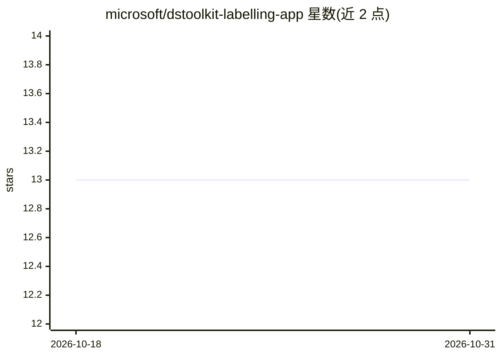

# microsoft/dstoolkit-labelling-app

⭐ 13 · Python · NOASSERTION · 推送 2026-04-01 · [GitHub](https://github.com/microsoft/dstoolkit-labelling-app) · 组织维护

**收集专家对 ML 输出反馈的标注 Web 应用**

微软开源的 Streamlit Web 应用，用于让领域专家（SME）对机器学习生成的输出进行快速反馈标注：支持按样本记录高层反馈与局部细节分析、会话进度保存与自动重载、通过 Azure Blob Storage 管理数据与用户凭据。包含面向数据科学家与项目经理的 Data Analysis View，提供标注进度监控、跨实验统计对比、ML 指标与人工评分的相关性可视化及 Top-10 最差样本视图。应用自身不实现访问控制，需置于网关之后部署，不适合高保密数据。

## 筛选速览

| 维度 | 判定 | 备注 |
|---|---|---|
| AI 角色 | `ai-ecosystem` | LLM/agent 周边工具 |
| 许可风险 | `none` | NOASSERTION |
| 部署形态 | `self-host` | docker 或自建部署 |
| 模型依赖 | — | README 未给出锁定关系 |
| 硬件要求 | — | 无带数字的原话,不猜 |
| 安装摩擦 | `low` | 无编译、无系统依赖或容器化 |
| 成熟度 | — | 结构信号不足 |

## 能力要点

- SME 按样本与局部细节两层记录反馈，进度自动保存
- 基于 Azure Blob Storage 的数据与用户凭据管理
- Data Analysis View 提供进度监控、跨实验对比与相关性热图
- 支持通过 CustomFormHandler 基类扩展自定义反馈表单

## 适用场景

- 组织领域专家对模型生成结果做人工评分与标注
- 数据科学家监控标注进度并分析人工反馈与 ML 指标的相关性
- 定位低分样本以指导模型改进

## 场景标签

`模型评测` · 领域:评测与运维

## 证据(README 行号)

> L3: This repository contains a web application developed with Streamlit for quick collection of feedback from Subject Ma
> L70: The Data Analysis View is a specialized dashboard for data scientists and project managers to monitor labelling pro

## 星数曲线

2026-10-18 13 → 2026-10-31 13（+0）

---
*卡片 v1 · prompt 1.4 · 生成 2026-10-31 · 置信度 high · 依据 README sha `3d946370d9f8` · [字段定义](../../DATASET.md)*
