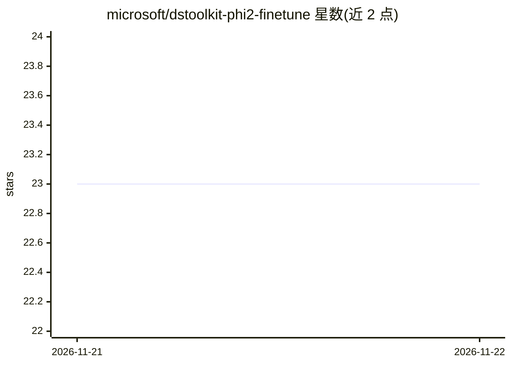

# microsoft/dstoolkit-phi2-finetune

⭐ 23 · Jupyter Notebook · NOASSERTION · 推送 2026-11-20 · [GitHub](https://github.com/microsoft/dstoolkit-phi2-finetune) · 组织维护

**用自有数据微调 Phi-2 模型的分步教程仓库**

微软员工发布的教程型仓库，包含三个文件：requirements.txt（Python 3.9.18 环境依赖清单）、phi2Finetune.ipynb（逐步演示用自有数据微调 Phi-2 的自包含 notebook）和取自 Microsoft 365 FAQ 的示例问答数据（可直接运行或作为自备数据模板）。README 说明可在显存约 4-5GB 的本地 GPU 上训练，作者实际使用 Azure ML 的 Standard_NC6s_v3 虚拟机（1 x NVIDIA Tesla V100）完成，入门步骤为创建 GPU 环境、克隆仓库、建环境后按 notebook 执行。

## 筛选速览

| 维度 | 判定 | 备注 |
|---|---|---|
| AI 角色 | `ai-knowledge` | 知识聚合/清单类 |
| 许可风险 | `none` | NOASSERTION |
| 部署形态 | `None` |  |
| 模型依赖 | — | README 未给出锁定关系 |
| 硬件要求 | `gpu-8g` | |
| 安装摩擦 | `low` | 无编译、无系统依赖或容器化 |
| 成熟度 | — | 结构信号不足 |

## 能力要点

- 自包含 notebook 提供逐步微调指引
- 附 Microsoft 365 FAQ 示例问答数据（xlsx）
- requirements.txt 固定 Python 3.9.18 环境依赖

## 适用场景

- 用自己的问答数据微调 Phi-2 模型
- 参考示例数据格式准备自有训练数据
- 在 Azure ML GPU 虚拟机上运行微调流程

## 场景标签

`教程课程` `微调` · 领域:学习与行业

## 证据(README 行号)

> L4: This repository contains step by step instructions on how to finetune Microsoft's Phi-2 model with your own data. Yo
> L12: (1) contains the required python libaries which need to be installed on a new enviroment (exact Python version was 

## 星数曲线

2026-11-21 23 → 2026-11-22 23（+0）

---
*卡片 v1 · prompt 1.4 · 生成 2026-11-21 · 置信度 high · 依据 README sha `33bdd18a7ee9` · [字段定义](../../DATASET.md)*
