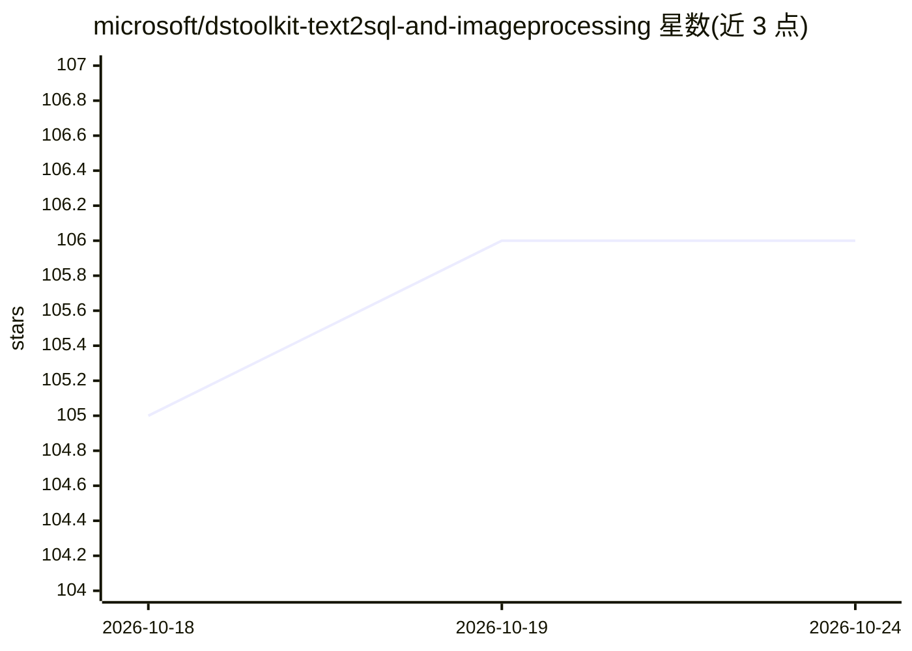

# microsoft/dstoolkit-text2sql-and-imageprocessing

⭐ 106 · Python · MIT · 推送 2026-10-24 · [GitHub](https://github.com/microsoft/dstoolkit-text2sql-and-imageprocessing) · [官网](https://www.ds-toolkit.com/) · 组织维护

**给 RAG 开发者的示例代码库：Text2SQL 与文档图像处理插件**

Microsoft 维护的示例代码仓库，面向构建 RAG 应用（新建或已有）的开发者。提供三类组件：text_2_sql 含三种 Multi-Shot Text2SQL 实现（prompt 向量两种路径及带查询缓存的向量迭代版），使 RAG 应用可从 SQL 表取数作答；image_processing 将 Azure Document Intelligence 与 AI Search 连接，用多模态模型（gpt4o）解读含图表的复杂文档，并含 Semantic Text Chunking 方法；另提供部署 AI Search 索引的 Python 工具。README 声明代码为加速器，生产使用前需审查调整；依赖管理使用 uv。

## 筛选速览

| 维度 | 判定 | 备注 |
|---|---|---|
| AI 角色 | `ai-ecosystem` | LLM/agent 周边工具 |
| 许可风险 | `permissive` | MIT |
| 部署形态 | `None` |  |
| 模型依赖 | — | README 未给出锁定关系 |
| 硬件要求 | — | 无带数字的原话,不猜 |
| 安装摩擦 | `low` | 无编译、无系统依赖或容器化 |
| 成熟度 | — | 结构信号不足 |

## 能力要点

- 三种 Multi-Shot Text2SQL 实现（prompt 向量 + 查询缓存迭代）
- Azure Document Intelligence + AI Search 处理含图表文档，多模态模型（gpt4o）解读
- Semantic Text Chunking 智能分句并保留图表完整性
- 部署 AI Search 索引、索引器与 skillset 的 Python 工具

## 适用场景

- 为已有 RAG 应用增加 SQL 数据库问答能力
- 让 RAG 应用在向量检索中利用复杂图表与图像内容
- 快速部署 AI Search 的索引与 Text2SQL 相关资源

## 场景标签

`RAG` `数据分析` `文档解析` · 领域:效率与自动化

## 证据(README 行号)

> L5: This repo provides sample code for improving RAG applications with rich data sources including SQL Warehouses and do
> L7: It is intended that the plugins and skills provided in this repository, are adapted and added to your new or existin
> L17: - `./text_2_sql` contains an three Multi-Shot implementations for Text2SQL generation and querying which can be use

## 星数曲线

2026-10-18 105 → 2026-10-24 106（+1）

---
*卡片 v1 · prompt 1.4 · 生成 2026-10-23 · 置信度 high · 依据 README sha `2441c72b74e7` · [字段定义](../../DATASET.md)*
