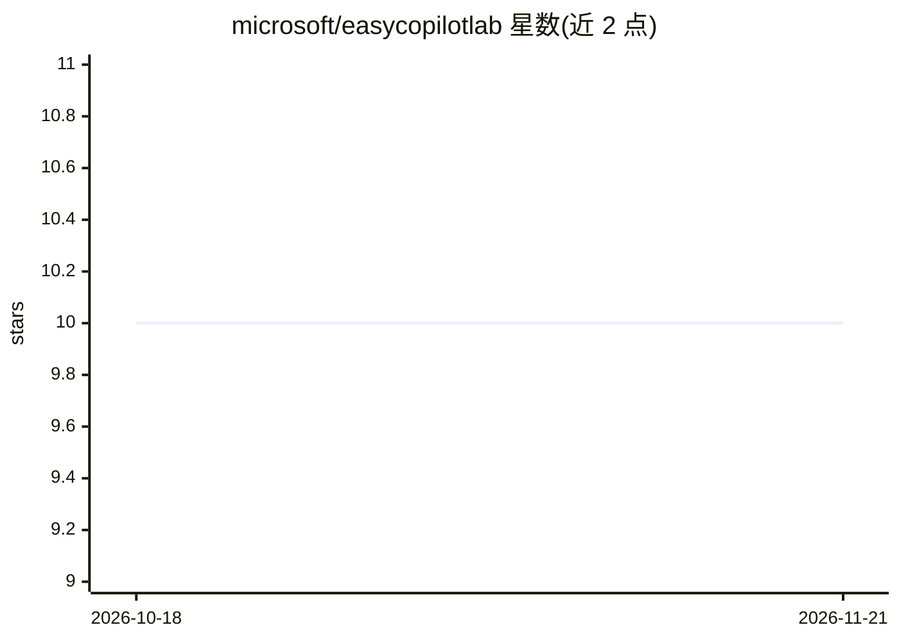

# microsoft/easycopilotlab

⭐ 10 · HTML · MIT · 推送 2026-11-19 · [GitHub](https://github.com/microsoft/easycopilotlab) · 组织维护

**教非开发者零代码构建首个 AI agent 的教程项目**

面向非开发者的学习项目，主题是使用 Copilot Studio 在无代码条件下构建第一个 AI agent。README 仅包含标题、一句定位描述与目录占位内容，未给出安装步骤、运行要求或功能清单；可验证信息以教程/引导性质为主，具体章节内容在当前可见范围内无法确认。

## 筛选速览

| 维度 | 判定 | 备注 |
|---|---|---|
| AI 角色 | `ai-knowledge` | 知识聚合/清单类 |
| 许可风险 | `permissive` | MIT |
| 部署形态 | `None` |  |
| 模型依赖 | — | README 未给出锁定关系 |
| 硬件要求 | — | 无带数字的原话,不猜 |
| 安装摩擦 | `low` | 无编译、无系统依赖或容器化 |
| 成熟度 | — | 结构信号不足 |

## 能力要点

- 面向非开发者（non-developers）受众
- 以 Copilot Studio 为构建工具的零代码方式
- 目标是教会用户构建第一个 AI agent

## 适用场景

- 我不写代码，想学会搭建一个 AI agent
- 想入门 Copilot Studio 的零代码构建流程

## 场景标签

`教程课程` · 领域:学习与行业

## 证据(README 行号)

> L2: Copilot Studio for non-developers — Learn to build your first AI agent without coding.

## 星数曲线

2026-10-18 10 → 2026-11-21 10（+0）

---
*卡片 v1 · prompt 1.4 · 生成 2026-11-19 · 置信度 mid · 依据 README sha `006beba5189c` · [字段定义](../../DATASET.md)*
