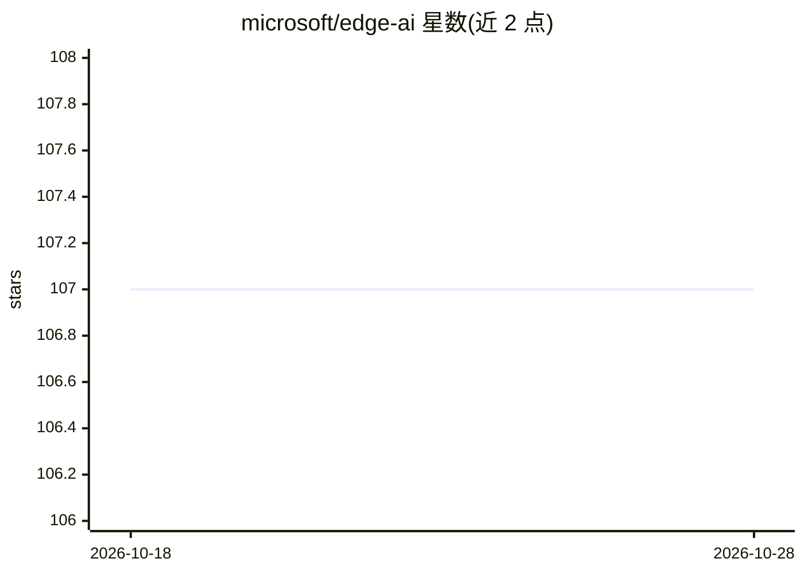

# microsoft/edge-ai

⭐ 107 · HCL · MIT · 推送 2026-10-28 · [GitHub](https://github.com/microsoft/edge-ai) · 组织维护

**面向团队的边缘 AI 基础设施即代码与应用组件集（Azure）**

微软维护的边缘 AI 基础设施仓库：提供 Terraform/Bicep 基础设施即代码、模块化组件（云服务、Kubernetes/Azure IoT Operations 边缘平台、AI 推理与遥测应用框架）及可部署蓝图（单节点边缘、多节点集群、纯云、最小 PoC）。面向平台工程师、DevOps 团队与方案架构师，面向 Azure 部署；通过 Dev Container（依赖 Docker、VS Code、GitHub Copilot）进行快速上手开发。

## 筛选速览

| 维度 | 判定 | 备注 |
|---|---|---|
| AI 角色 | `ai-ecosystem` | LLM/agent 周边工具 |
| 许可风险 | `permissive` | MIT |
| 部署形态 | `None` |  |
| 模型依赖 | — | README 未给出锁定关系 |
| 硬件要求 | — | 无带数字的原话,不猜 |
| 安装摩擦 | `low` | 无编译、无系统依赖或容器化 |
| 成熟度 | — | 结构信号不足 |

## 能力要点

- Terraform 与 Bicep 两种 IaC 框架
- 模块化组件：云服务/边缘平台/AI 推理与遥测框架
- 四类部署蓝图：单节点/多节点/纯云/最小 PoC
- 可将仓库的 AI 指令与自定义 agent 挂载到其他项目复用

## 适用场景

- 平台工程师快速部署边缘 AI 基础设施到 Azure
- DevOps 团队按蓝图搭建 IoT/边缘集群
- 团队复用其 AI 辅助开发工作流与自定义 agent 到自己的仓库

## 场景标签

 · 领域:云计算/边缘基础设施

## 证据(README 行号)

> L9: Production-ready Infrastructure as Code that empowers organizations to achieve more with edge AI solutions. Built by
> L54: - **Cloud services** (identity, data, messaging, observability)
> L95: - **Multiple IaC frameworks** - Terraform & Bicep

## 星数曲线

2026-10-18 107 → 2026-10-28 107（+0）

---
*卡片 v1 · prompt 1.4 · 生成 2026-10-23 · 置信度 high · 依据 README sha `ff009e94916e` · [字段定义](../../DATASET.md)*
