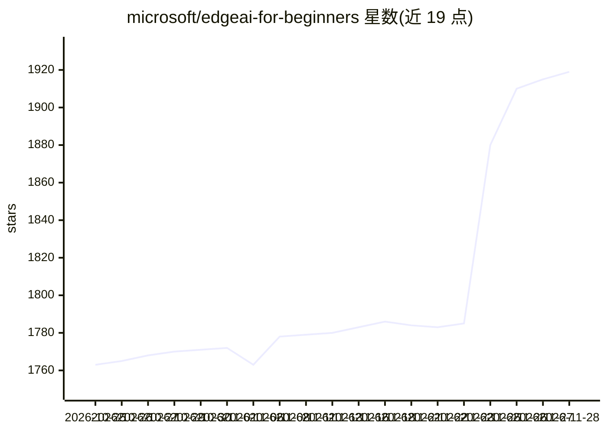

# microsoft/edgeai-for-beginners

⭐ 1,919 · Jupyter Notebook · MIT · 推送 2026-11-22 · [GitHub](https://github.com/microsoft/edgeai-for-beginners) · 组织维护

**面向初学者的边缘 AI 课程：从概念到端侧部署实操**

微软维护的边缘 AI（Edge AI）教学课程，按 00-08 九个模块组织，覆盖边缘 AI 基础概念、SLM 模型家族（Phi/Qwen/Gemma/BitNET）、本地与云端部署、模型优化工具（Llama.cpp/Olive/OpenVINO/MLX）、SLMOps、AI Agent 与 MCP，以及 Foundry Local 示例应用。含 36-45 小时学习路径、workshop 实操（6 次课程 Python 示例、8 个 Jupyter 笔记本）和一个全本地运行的 AI 播客制作多 Agent 项目。

## 筛选速览

| 维度 | 判定 | 备注 |
|---|---|---|
| AI 角色 | `ai-knowledge` | 知识聚合/清单类 |
| 许可风险 | `permissive` | MIT |
| 部署形态 | `None` |  |
| 模型依赖 | local-ok | 支持本地模型 |
| 硬件要求 | — | 无带数字的原话,不猜 |
| 安装摩擦 | `low` | 无编译、无系统依赖或容器化 |
| 成熟度 | — | 结构信号不足 |

## 能力要点

- 9 个模块覆盖边缘 AI 概念、SLM、优化、部署到 Agent
- workshop 提供 Python 示例、Jupyter 笔记本与验证脚本
- AI 播客 studio 项目：Ollama + Qwen-3-8B 全本地多 Agent 流水线
- 50+ 语言翻译版本，支持 sparse checkout 减小克隆体积

## 适用场景

- 系统学习边缘 AI 与小型语言模型的基础知识
- 照着示例在本地设备上部署和量化 SLM
- 学习构建本地多 Agent 编排与 RAG 应用

## 场景标签

`教程课程` · 领域:学习与行业

## 证据(README 行号)

> L49: ## Introduction
> L96: |Module|Topic|Focus Area|Key Content|Level|Duration|

## 星数曲线

2026-10-25 1,763 → 2026-11-28 1,919（+156）

---
*卡片 v1 · prompt 1.4 · 生成 2026-11-23 · 置信度 high · 依据 README sha `e312e0b52c42` · [字段定义](../../DATASET.md)*
