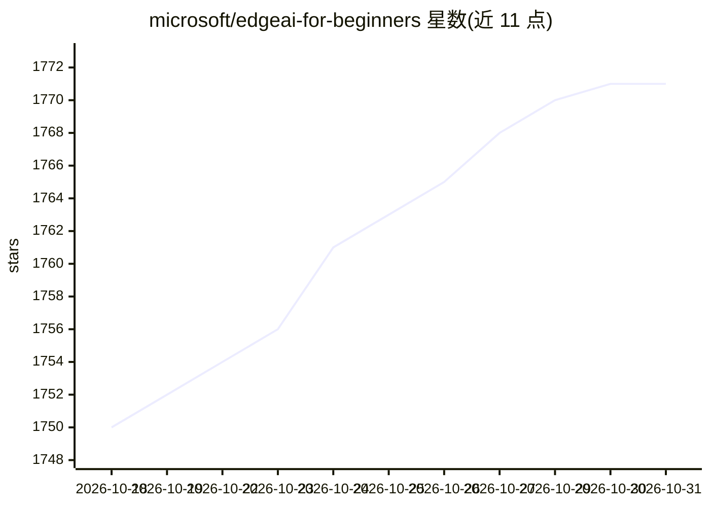

# microsoft/edgeai-for-beginners

⭐ 1,771 · Jupyter Notebook · MIT · 推送 2026-10-26 · [GitHub](https://github.com/microsoft/edgeai-for-beginners) · 组织维护

**微软出品的 Edge AI 初学者课程（9 模块+工作坊）**

Microsoft 维护的 Edge AI 入门课程仓库：以 9 个模块（共约 36-45 小时）覆盖 Edge AI 基础、SLM 模型家族（Phi/Qwen/Gemma 等）、本地与云端部署、模型优化（Llama.cpp/Olive/OpenVINO/MLX）、SLMOps、AI Agent 与 Function Calling 及 Foundry Local 平台实践，附 10 个示例应用与动手工作坊（含基于 Ollama+Qwen-3-8B 的本地 AI 播客多 Agent 工作坊）。内容以 Markdown 教程、Python 示例与 Jupyter Notebook 形式提供，支持 50+ 语言翻译，通过 git clone 获取。

## 筛选速览

| 维度 | 判定 | 备注 |
|---|---|---|
| AI 角色 | `ai-knowledge` | 知识聚合/清单类 |
| 许可风险 | `permissive` | MIT |
| 部署形态 | `None` |  |
| 模型依赖 | — | README 未给出锁定关系 |
| 硬件要求 | — | 无带数字的原话,不猜 |
| 安装摩擦 | `low` | 无编译、无系统依赖或容器化 |
| 成熟度 | — | 结构信号不足 |

## 能力要点

- 9 个模块覆盖 SLM、模型优化、SLMOps、Agent 到生产部署全流程
- Module 08 提供 10 个 Foundry Local 示例应用（聊天、RAG、多 Agent、模型路由等）
- AI 播客工作室工作坊：Ollama + Qwen-3-8B 全本地多 Agent 流水线
- 支持 50+ 语言翻译，并提供 sparse checkout 精简克隆方式

## 适用场景

- 零基础系统学习 Edge AI 与小语言模型部署
- 通过本地多 Agent 播客工作坊实践 Agent 编排
- 查找跨平台模型量化与优化工具（Llama.cpp/Olive/OpenVINO/MLX）入门路径

## 场景标签

`教程课程` · 领域:学习与行业

## 证据(README 行号)

> L98: |📖 00|Introduction to EdgeAI|Foundation & Context|EdgeAI Overview • Industry Applications • SLM Introduction • Lear
> L126: - **Python Samples** (6 sessions) - Updated with best practices, error handling, and comprehensive documentation

## 星数曲线

2026-10-18 1,750 → 2026-10-31 1,771（+21）

---
*卡片 v1 · prompt 1.4 · 生成 2026-10-21 · 置信度 high · 依据 README sha `f06d450d5439` · [字段定义](../../DATASET.md)*
