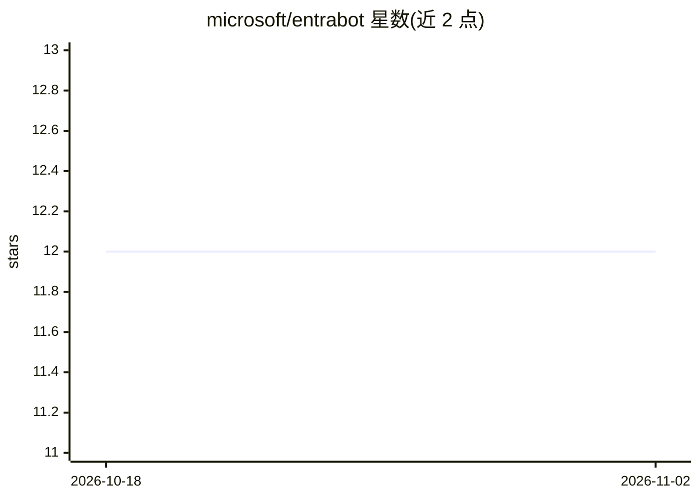

# microsoft/entrabot

⭐ 12 · Python · MIT · 推送 2026-10-28 · [GitHub](https://github.com/microsoft/entrabot) · [官网](https://microsoft.github.io/entrabot/) · 组织维护

**给设备本地 AI agent 分配 Microsoft Entra 身份的 MCP 服务器参考实现**

微软开源的 Python MCP 服务器参考实现：为设备本地 LLM agent 在 Entra 中配置 Agent Identity Blueprint、Agent Identity 与 Agent User，通过三跳证书链（Blueprint token→Agent Identity token→Agent User token）实现无人参与的自主认证，使 agent 以自身身份收发 Teams 消息、使用邮箱、操作 Microsoft 365 文件并写入审计事件。支持 macOS/Linux/Windows，配合 Claude Code、Copilot CLI 等 MCP 客户端使用。自述为研究仓库/原型，未打包为生产服务，需要 M365 开发租户、含 Teams/Outlook 的许可证与 Python 3.12。

## 筛选速览

| 维度 | 判定 | 备注 |
|---|---|---|
| AI 角色 | `ai-ecosystem` | LLM/agent 周边工具 |
| 许可风险 | `permissive` | MIT |
| 部署形态 | `library` | 以包/库形式分发 |
| 模型依赖 | — | README 未给出锁定关系 |
| 硬件要求 | — | 无带数字的原话,不猜 |
| 安装摩擦 | `low` | 无编译、无系统依赖或容器化 |
| 成熟度 | `idea` | |

## 能力要点

- 三跳证书链认证，私钥存于 OS 密钥库（Keychain/CNG/Secret Service）
- agent 以自身对象 ID 进行 Teams 消息、Outlook、SharePoint/OneDrive 操作与审计
- Claude Code 通道推送将入站 Teams 消息直接送达 LLM，其他主机走轮询回退
- 审计失败即阻断操作（fails closed），每次提交通过 pytest 与 ruff 检查

## 适用场景

- 让 M365 上的 agent 拥有独立身份、审计与条件访问策略
- 构建可自主登录并收发 Teams 消息的设备本地 agent
- 研究 Entra Agent ID / Agent 365 的身份模式并复制到自己的实现

## 场景标签

 · 领域:AI agent 身份与安全/Microsoft 365

## 证据(README 行号)

> L3: Entrabot is a Python MCP server that gives a device-local agent its own Entra **Agent ID** and **Agent User**. The a
> L35: - **FastMCP** — the Python MCP server framework. entrabot registers every Teams, Outlook, Files, Word, audit, and i
> L17: A device-local MCP server that turns an LLM agent into a first-class principal in Microsoft Entra. Three things cha

## 星数曲线

2026-10-18 12 → 2026-11-02 12（+0）

---
*卡片 v1 · prompt 1.4 · 生成 2026-11-01 · 置信度 mid · 依据 README sha `a8671938a4e1` · [字段定义](../../DATASET.md)*
