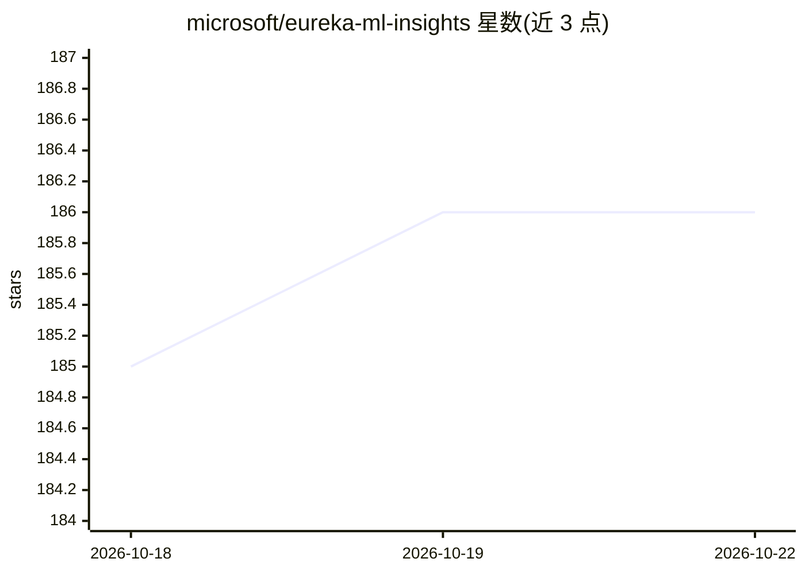

# microsoft/eureka-ml-insights

⭐ 186 · Python · Apache-2.0 · 推送 2026-06-16 · [GitHub](https://github.com/microsoft/eureka-ml-insights) · [官网](https://microsoft.github.io/eureka-ml-insights) · 组织维护

**微软的大模型评测框架：可复现的多基准评测流水线**

面向研究者和实践者的生成式模型评测框架，提供数据处理、推理、评测、报告等可组合的流水线组件（PromptProcessing/Inference/EvalReporting 等），并内置 Eureka-Bench 十余个基准的预定义流水线（数学推理、长文本 QA、空间理解、毒性检测等），实验日志托管于 HuggingFace。支持配置 OpenAI 系列模型类与 Llama.cpp 本地推理（LlamaCppModel）。通过 pip/Conda 安装，仅支持 Unix/Linux，不支持 Windows；GPU 依赖为可选。

## 筛选速览

| 维度 | 判定 | 备注 |
|---|---|---|
| AI 角色 | `ai-ecosystem` | LLM/agent 周边工具 |
| 许可风险 | `permissive` | Apache-2.0 |
| 部署形态 | `library` | 以包/库形式分发 |
| 模型依赖 | — | README 未给出锁定关系 |
| 硬件要求 | — | 无带数字的原话,不猜 |
| 安装摩擦 | `medium` | 含编译或系统依赖之一 |
| 成熟度 | — | 结构信号不足 |

## 能力要点

- 可组合流水线组件：数据处理、推理、评测与报告生成
- 内置十余个基准（AIME、GPQA、FlenQA、MMMU 等）的预定义实验流水线
- 支持 OpenAI 模型类（AzureOpenAIModel/DirectOpenAIModel）与 Llama.cpp 本地推理
- 提供非确定性评测流水线（nondeterminism.py）

## 适用场景

- 复现或运行基准实验，生成超越单一分数的评测报告
- 自定义数据处理-推理-评测流水线评估自家或第三方模型
- 研究推理时间扩展等问题的规模化实验

## 场景标签

`模型评测` · 领域:评测与运维

## 证据(README 行号)

> L6: This repository contains the code for the Eureka ML Insights framework. The framework is designed to help researcher
> L87: ## 🗺️ Overview of Experiment Pipelines
> L95: - `EvalReporting`: you can use this component to evaluate the model outputs using various metrics, aggregators and 

## 星数曲线

2026-10-18 185 → 2026-10-22 186（+1）

---
*卡片 v1 · prompt 1.4 · 生成 2026-10-22 · 置信度 high · 依据 README sha `008fc4b01e18` · [字段定义](../../DATASET.md)*
