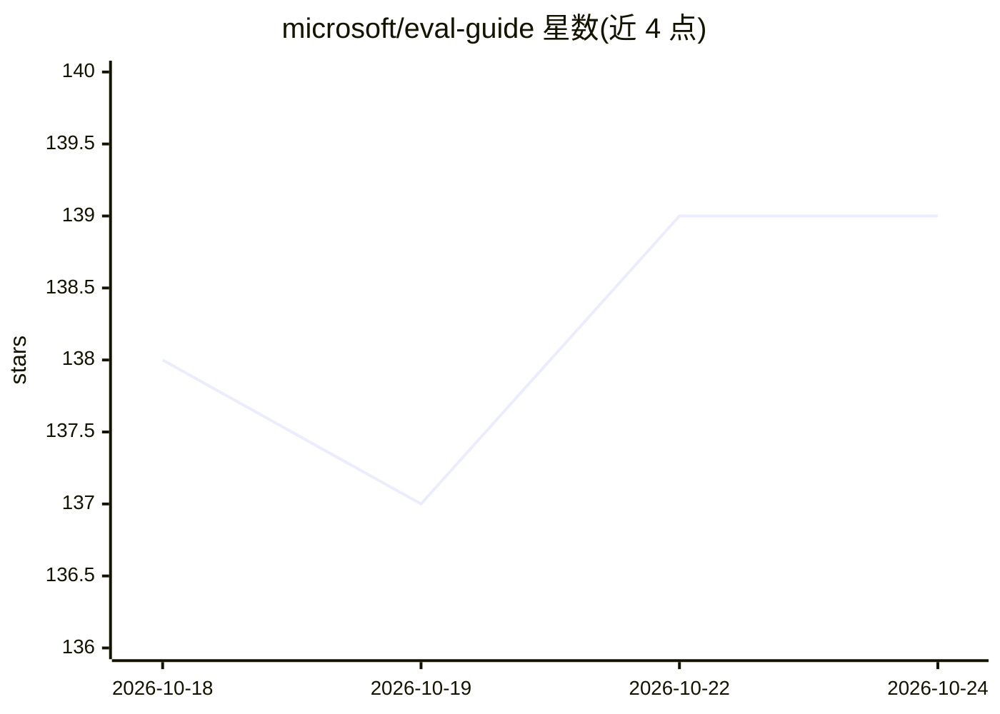

# microsoft/eval-guide

⭐ 139 · HTML · MIT · 推送 2026-06-24 · [GitHub](https://github.com/microsoft/eval-guide) · 组织维护

**面向 Copilot Studio agent 的评测插件：规划、生成用例、解读结果**

由 Microsoft 维护的 AI agent 评测工具包，以 Claude Code 插件或 GitHub Copilot 技能形式安装，提供 6 个命令覆盖评测全流程：发现与规划（按 agent 架构与风险分级界定评测范围）、生成单轮/多轮测试用例 CSV（可导入 Copilot Studio）、解读结果（SHIP/ITERATE/BLOCK 判定与根因分类）及失败诊断改进。每阶段生成本地 HTML 交互面板供人工审阅编辑，方法论基于 Microsoft 10 步评测手册；无运行中的 agent 时可仅凭描述工作（description-based 模式）。

## 筛选速览

| 维度 | 判定 | 备注 |
|---|---|---|
| AI 角色 | `ai-ecosystem` | LLM/agent 周边工具 |
| 许可风险 | `permissive` | MIT |
| 部署形态 | `library` | 以包/库形式分发 |
| 模型依赖 | — | README 未给出锁定关系 |
| 硬件要求 | — | 无带数字的原话,不猜 |
| 安装摩擦 | `low` | 无编译、无系统依赖或容器化 |
| 成熟度 | — | 结构信号不足 |

## 能力要点

- 6 个技能命令覆盖评测规划、用例生成、结果解读与失败诊断
- 按 agent 架构（Prompt 级/RAG/Agentic）自动界定评测深度
- 每阶段生成本地零依赖 HTML 面板供人工审阅，确认后才产出最终文件
- 单轮与多轮两种评测模式，产出 Copilot Studio 可导入的 CSV

## 适用场景

- 为新构建的 agent 制定评测计划并生成测试用例
- 解读评测结果并定位失败根因（评测配置 vs agent 质量）
- 在 Copilot Studio 中对上线 agent 做回归测试

## 场景标签

`模型评测` · 领域:评测与运维

## 证据(README 行号)

> L3: AI agent evaluation toolkit for Copilot Studio. Plan evals, generate test cases, interpret results, and triage failu
> L26: |**Eval Guide**|`/eval-guide`|Full eval lifecycle — discover, plan, generate, run, interpret. Start here.|
> L29: |**Eval Result Interpreter**|`/eval-result-interpreter`|SHIP / ITERATE / BLOCK verdict with root cause classificati

## 星数曲线

2026-10-18 138 → 2026-10-24 139（+1）

---
*卡片 v1 · prompt 1.4 · 生成 2026-10-22 · 置信度 high · 依据 README sha `41a5debcb410` · [字段定义](../../DATASET.md)*
