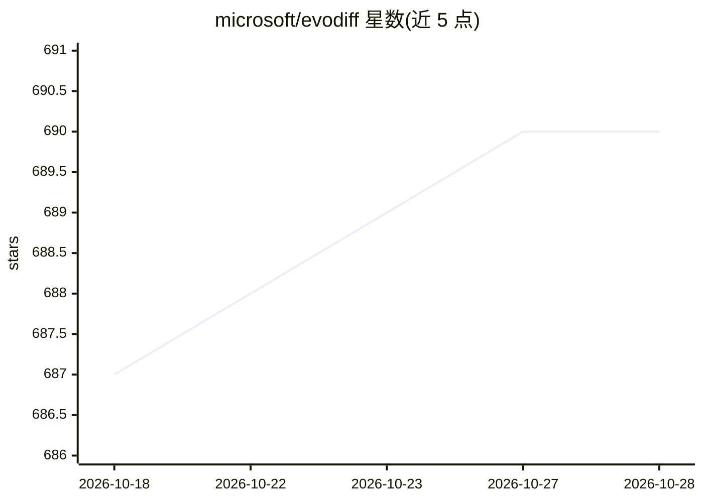

# microsoft/evodiff

⭐ 690 · Python · MIT · 推送 2026-01-15 · [GitHub](https://github.com/microsoft/evodiff) · 组织维护

**序列空间蛋白质生成框架：离散扩散模型产出序列与比对**

微软开源的蛋白质序列生成框架，基于离散扩散模型（OADM 与 D3PM 两种前向过程）在序列空间生成蛋白质序列与多序列比对（MSA），提供 38M/640M 参数的 EvoDiff-Seq 与 EvoDiff-MSA 预训练模型。支持无条件生成、以 MSA 为条件的进化引导生成、内在无序区域（IDR）inpainting 与功能基序支架设计。训练数据来自 UniRef50（42M 序列）与 OpenFold 数据集；部分任务需下载对应数据集。以 Python 包与脚本形式提供，附 notebook 示例，可部署至 Azure AI Foundry 与 Hugging Face Space。

## 筛选速览

| 维度 | 判定 | 备注 |
|---|---|---|
| AI 角色 | `ai-native` | 本体是模型或模型工具 |
| 许可风险 | `permissive` | MIT |
| 部署形态 | `self-host` | docker 或自建部署 |
| 模型依赖 | — | README 未给出锁定关系 |
| 硬件要求 | — | 无带数字的原话,不猜 |
| 安装摩擦 | `low` | 无编译、无系统依赖或容器化 |
| 成熟度 | — | 结构信号不足 |

## 能力要点

- OADM/D3PM 两种离散扩散前向过程，38M/640M 参数预训练模型
- EvoDiff-MSA 利用进化信息做 MSA 条件生成
- 支持 IDR inpainting 与功能基序支架（motif scaffolding）条件生成
- 自带 Omegafold ESM-IF 自洽性评估管线

## 适用场景

- 无条件批量生成蛋白质序列或 MSA
- 给定比对生成蛋白家族新成员，或由查询序列生成比对
- 围绕结构化区域设计内在无序区域（IDR）
- 固定功能基序氨基酸序列，生成支架序列

## 场景标签

`模型训练` · 领域:训练与推理

## 证据(README 行号)

> L4: In this work, we introduce a general-purpose diffusion framework, EvoDiff, that combines evolutionary-scale data wit
> L109: python evodiff/generate.py --model-type oa_dm_38M --num-seqs 100
> L132: To explicitly leverage evolutionary information, we design and train EvoDiff-MSA models using the MSA Transformer 

## 星数曲线

2026-10-18 687 → 2026-10-28 690（+3）

---
*卡片 v1 · prompt 1.4 · 生成 2026-10-21 · 置信度 mid · 依据 README sha `e6e010bbae11` · [字段定义](../../DATASET.md)*
