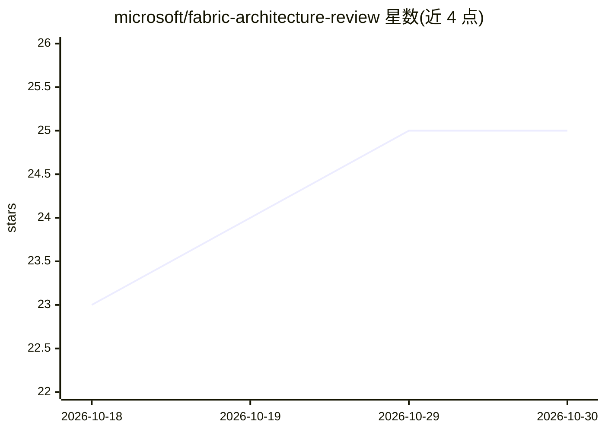

# microsoft/fabric-architecture-review

⭐ 25 · Python · NOASSERTION · 推送 2026-10-29 · [GitHub](https://github.com/microsoft/fabric-architecture-review) · 组织维护

**给企业评审团队的 Microsoft Fabric 租户架构审查加速器**

面向 Microsoft Fabric 租户的端到端架构评审工具：仅扫描元数据（不查询业务数据行），以 70 条规则覆盖架构、治理、运营、可靠性、安全五个维度并评分，产出顾问式报告、Power BI 治理模型、对话式 Data Agent 与本地 Markdown/PDF 报告。可在 Fabric 内部署流水线或本地三阶段运行，通过 Variable Library 或 .env.far/thresholds.yaml 配置。可选 FUAM/FCA 连接补充活动与容量证据；强调评审元数据仍可能敏感，需按权限指南部署。要求 Python 3.11+。

## 筛选速览

| 维度 | 判定 | 备注 |
|---|---|---|
| AI 角色 | `ai-enhanced` | 去掉 AI 部分产品仍成立 |
| 许可风险 | `permissive` | NOASSERTION |
| 部署形态 | `None` |  |
| 模型依赖 | — | README 未给出锁定关系 |
| 硬件要求 | — | 无带数字的原话,不猜 |
| 安装摩擦 | `low` | 无编译、无系统依赖或容器化 |
| 成熟度 | — | 结构信号不足 |

## 能力要点

- 70 条规则、五维度评分，缺失证据不计为通过
- 仅元数据扫描，不采集业务数据行、源代码或筛选表达式
- 支持 Fabric 内部署与本地三阶段运行两种方式
- 可选工作区所有者分权报告与 FUAM/FCA 证据增强

## 适用场景

- 评审团队对 Fabric 租户做治理与安全体检
- 按工作区范围生成带行动计划的架构评审报告
- 通过对话式 Agent 或 Power BI 模型浏览评审结果

## 场景标签

 · 领域:数据治理/云计算平台运维

## 证据(README 行号)

> L6: Assess the architecture, governance and security of your Microsoft Fabric estate.
> L10: Explore results in Power BI, the FAR app, a Data Agent or local Markdown/PDF reports.
> L63: - **Agents, app and ontology:** explore results conversationally or visually.

## 星数曲线

2026-10-18 23 → 2026-10-30 25（+2）

---
*卡片 v1 · prompt 1.4 · 生成 2026-10-27 · 置信度 high · 依据 README sha `323bfd4d3f63` · [字段定义](../../DATASET.md)*
