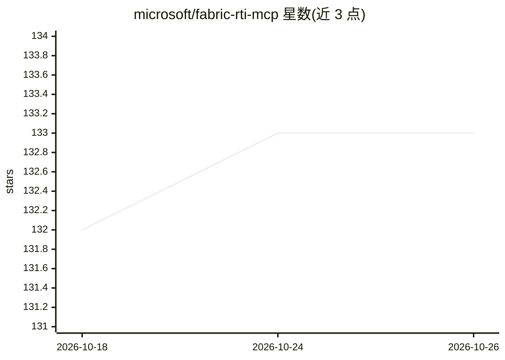

# microsoft/fabric-rti-mcp

⭐ 133 · Python · MIT · 推送 2026-10-24 · [GitHub](https://github.com/microsoft/fabric-rti-mcp) · 组织维护

**让 AI agent 通过 MCP 操作 Fabric 实时智能服务的服务器**

Microsoft 维护的 MCP 服务器，作为 AI agent 与 Microsoft Fabric Real-Time Intelligence 服务之间的桥接层：通过 MCP 协议暴露 39+ 工具，支持对 Eventhouse/Azure Data Explorer 执行 KQL 查询与管理命令、查询执行计划与集群诊断，管理 Eventstreams（含构建器工具）、创建 Activator 告警触发器和 Map 地理可视化。附 KQL Copilot Skill 供 agent 编写调试 KQL。认证走 Azure Identity，可从 PyPI 安装或从源码构建，需 Python 3.10+。项目处于 Public Preview，实现可能在 GA 前显著变化。

## 筛选速览

| 维度 | 判定 | 备注 |
|---|---|---|
| AI 角色 | `ai-ecosystem` | LLM/agent 周边工具 |
| 许可风险 | `permissive` | MIT |
| 部署形态 | `desktop` | 安装包/桌面程序 |
| 模型依赖 | — | README 未给出锁定关系 |
| 硬件要求 | — | 无带数字的原话,不猜 |
| 安装摩擦 | `low` | 无编译、无系统依赖或容器化 |
| 成熟度 | `idea` | |

## 能力要点

- Eventhouse 13+1 工具：KQL 查询/命令、schema 探查、执行计划与集群诊断
- Eventstreams 17 工具：核心操作与定义构建器（源/流/目标/校验）
- Activator 触发器（邮件/Teams 告警）与 Map 地理可视化工具
- KQL Copilot Skill 提供查询编写与纠错知识

## 适用场景

- 在 VS Code / Copilot 中用自然语言查询 Eventhouse 数据
- 通过对话创建和管理 Eventstream 实时数据流
- 基于 KQL 条件设置邮件或 Teams 告警

## 场景标签

`数据分析` · 领域:效率与自动化

## 证据(README 行号)

> L5: A comprehensive Model Context Protocol (MCP) server implementation for Microsoft Fabric Real-Time Intelligence (RTI)
> L15: - 🔄 **MCP Protocol**: Uses the Model Context Protocol to expose Fabric RTI capabilities as tools
> L16: - 🏗️ **Natural Language to KQL**: AI agents can translate natural language requests into KQL queries and Eventstrea

## 星数曲线

2026-10-18 132 → 2026-10-26 133（+1）

---
*卡片 v1 · prompt 1.4 · 生成 2026-10-22 · 置信度 high · 依据 README sha `08bace85f7df` · [字段定义](../../DATASET.md)*
