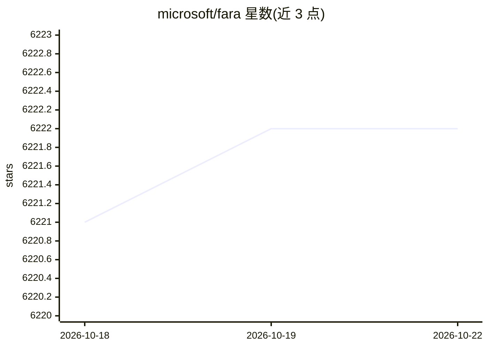

# microsoft/fara

⭐ 6,219 · Python · MIT · 推送 2026-09-22 · [GitHub](https://github.com/microsoft/fara) · [官网](https://www.microsoft.com/en-us/research/articles/fara1-5-computer-use-agent/) · 组织维护

**微软的计算机使用 agent 模型家族（4B/9B/27B）**

Fara1.5 是基于 Qwen3.5 训练的原生 Computer Use Agent 模型家族，含 4B/9B/27B 三个规模，通过观察-思考-行动循环在浏览器截图上直接输出鼠标键盘操作、网页搜索等动作，不依赖 accessibility tree。配套提供 FaraGen1.5 数据管线（约 200 万样本）、WebTailBench 与 CUAVerifierBench 两个评测基准、fara-cli 命令行与基于 Playwright 的评测基础设施。权重托管在 Hugging Face 与 Microsoft Foundry，可经 vLLM 本地部署；自述为 research preview，建议在沙箱中运行并避免敏感数据。

## 筛选速览

| 维度 | 判定 | 备注 |
|---|---|---|
| AI 角色 | `ai-native` | 本体是模型或模型工具 |
| 许可风险 | `permissive` | MIT |
| 部署形态 | `library` | 以包/库形式分发 |
| 模型依赖 | local-ok | 支持本地模型 |
| 硬件要求 | — | 无带数字的原话,不猜 |
| 安装摩擦 | `low` | 无编译、无系统依赖或容器化 |
| 成熟度 | `idea` | |

## 能力要点

- 三规模模型（4B/9B/27B）基于 Qwen3.5，直接预测坐标执行鼠标键盘操作
- 训练数据来自 FaraGen1.5 管线：约 200 万样本，含环境/求解器/验证器三组件
- 附 WebTailBench（609 任务）与 CUAVerifierBench 两个评测基准
- 提供 fara-cli、Fara-Agent 参考实现与 Playwright 评测环境

## 适用场景

- 让 agent 代为执行网页搜索、表单填写、订票购物等多步任务
- 在基准（Online-Mind2Web/WebVoyager/WebTailBench）上评测 CUA 模型
- 研究者基于 CUAVerifierBench 研究轨迹评分验证器与人工标注的一致性

## 场景标签

`浏览器自动化` `模型评测` · 领域:效率与自动化

## 证据(README 行号)

> L45: **Fara1.5** is a family of native Computer Use Agents (CUAs) at three scales — **Fara1.5-4B**, **Fara1.5-9B**, and 
> L97: - **Operate visually** by perceiving webpages and taking actions like scrolling, typing, and clicking on directly p
> L47: Fara1.5 models operate through an observe-think-act loop: given a screenshot of the browser and the conversation hi

## 星数曲线

2026-10-18 6,221 → 2026-10-22 6,222（+1）

---
*卡片 v1 · prompt 1.4 · 生成 2026-10-20 · 置信度 high · 依据 README sha `fda0e691fff8` · [字段定义](../../DATASET.md)*
