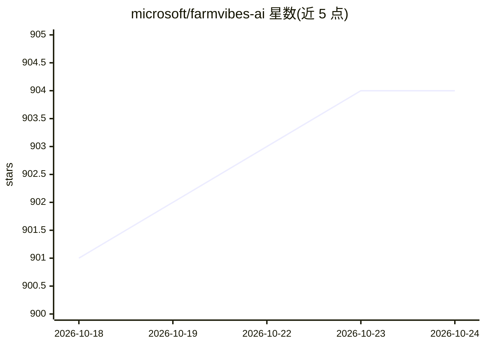

# microsoft/farmvibes-ai

⭐ 904 · Jupyter Notebook · MIT · 推送 2026-09-09 · [GitHub](https://github.com/microsoft/farmvibes-ai) · [官网](https://microsoft.github.io/farmvibes-ai/) · 组织维护

**面向农业与可持续性的多模态地理空间 ML 平台**

微软开源的地理空间机器学习平台，用于融合卫星影像（RGB/SAR/多光谱）、无人机影像、气象数据等多源时空数据集，构建面向农业与可持续性的洞察模型（如碳足迹估算、作物识别、收获期检测、微气候预测）。包含三部分：数据摄取与预处理工作流（DAG 配置）、模型训练 notebook 库、以及支持推理的计算引擎。工作流以 Docker 镜像形式在本地集群运行，通过 localhost REST API 或 Python 客户端交互。安装指引跳转至 Quickstart 与 Azure VM 部署文档。

## 筛选速览

| 维度 | 判定 | 备注 |
|---|---|---|
| AI 角色 | `ai-native` | 本体是模型或模型工具 |
| 许可风险 | `permissive` | MIT |
| 部署形态 | `None` |  |
| 模型依赖 | — | README 未给出锁定关系 |
| 硬件要求 | — | 无带数字的原话,不猜 |
| 安装摩擦 | `low` | 无编译、无系统依赖或容器化 |
| 成熟度 | — | 结构信号不足 |

## 能力要点

- 融合 Sentinel 1/2、USGS 高程、NOAA 气象等多源数据集的预处理工作流
- 内置收获期检测、碳足迹模拟、微气候预测、作物识别等训练 notebook
- 工作流以 DAG 定义，经 Docker 镜像在本地集群运行，结果本地持久化
- 通过 localhost REST API 或 Python 客户端（Jupyter 内）交互

## 适用场景

- 融合多源卫星与气象数据训练农业遥感模型
- 对特定区域和时间段运行作物识别或碳足迹推理
- 在本地机器上搭建地理空间数据融合的数据科学流水线

## 场景标签

`多模态` `模型训练` · 领域:感知与多模态

## 证据(README 行号)

> L5: Build models that fuse multiple geospatial and spatiotemporal datasets to obtain insights (e.g.
> L12: shown to be key for agriculture related problems) that help you build robust remote sensing, earth
> L21: Additionally, we provide model training notebook examples that not only allow the configuration

## 星数曲线

2026-10-18 901 → 2026-10-24 904（+3）

---
*卡片 v1 · prompt 1.4 · 生成 2026-10-21 · 置信度 high · 依据 README sha `b0956bc28bae` · [字段定义](../../DATASET.md)*
