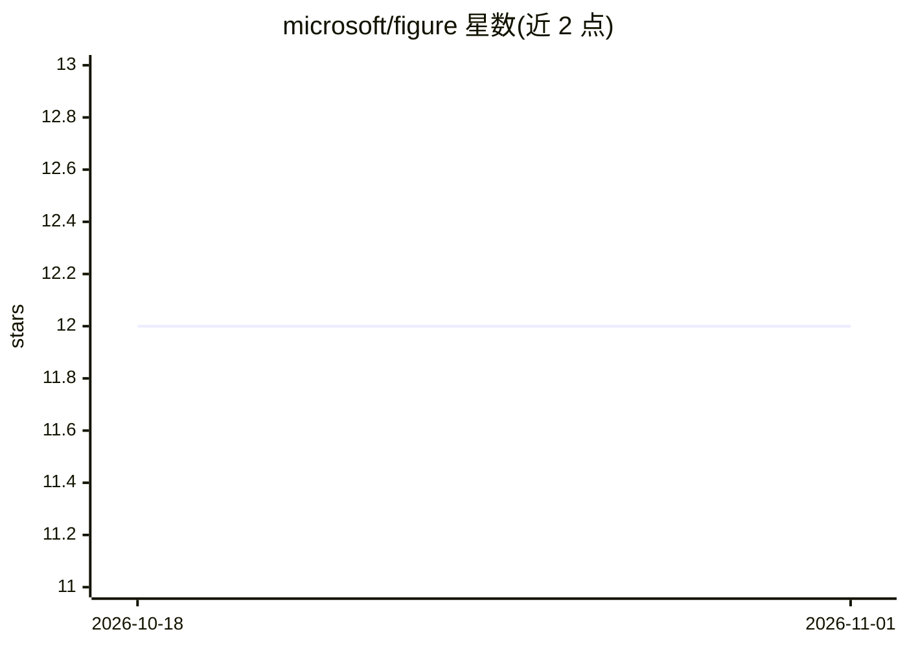

# microsoft/figure

⭐ 12 · Python · MIT · 推送 2026-10-29 · [GitHub](https://github.com/microsoft/figure) · [官网](https://neurips.cc/virtual/2023/poster/69941) · 组织维护

**NeurIPS'23 论文代码：基于滤波增强的无监督图节点表示学习**

微软团队论文 FiGURe 的官方代码仓库，提供无监督节点表示学习方法：通过基于滤波的增强捕获特征谱不同部分，跨滤波器共享权重以降低计算量，并用随机傅里叶特征投影在低维嵌入下恢复性能。面向科研复现：通过 conda 建环境（Python 3.10.11）、安装 OS 对应 requirements、下载公开数据集后运行 main.py 或 bash 脚本，覆盖 32/128/512 维三组实验。结果基于第一个数据划分，多划分平均可能与论文略有差异。

## 筛选速览

| 维度 | 判定 | 备注 |
|---|---|---|
| AI 角色 | `ai-native` | 本体是模型或模型工具 |
| 许可风险 | `permissive` | MIT |
| 部署形态 | `library` | 以包/库形式分发 |
| 模型依赖 | — | README 未给出锁定关系 |
| 硬件要求 | — | 无带数字的原话,不猜 |
| 安装摩擦 | `low` | 无编译、无系统依赖或容器化 |
| 成熟度 | — | 结构信号不足 |

## 能力要点

- 滤波增强捕获特征谱不同部分
- 跨滤波器共享权重降低计算量
- 随机傅里叶特征投影支持低维嵌入
- 提供 32/128/512 维三组复现 bash 脚本

## 适用场景

- 复现论文中的无监督节点表示实验结果
- 在同质与异质图数据集上做无监督节点分类
- 研究图对比学习中的特征谱增强方法

## 场景标签

 · 领域:图机器学习/科研

## 证据(README 行号)

> L1: # FiGURe: Simple and Efficient Unsupervised Node Representations with Filter Augmentations
> L18:  Unsupervised node representations learnt using contrastive learning-based methods have shown good performance on d

## 星数曲线

2026-10-18 12 → 2026-11-01 12（+0）

---
*卡片 v1 · prompt 1.4 · 生成 2026-11-01 · 置信度 high · 依据 README sha `3ba4eba4f003` · [字段定义](../../DATASET.md)*
