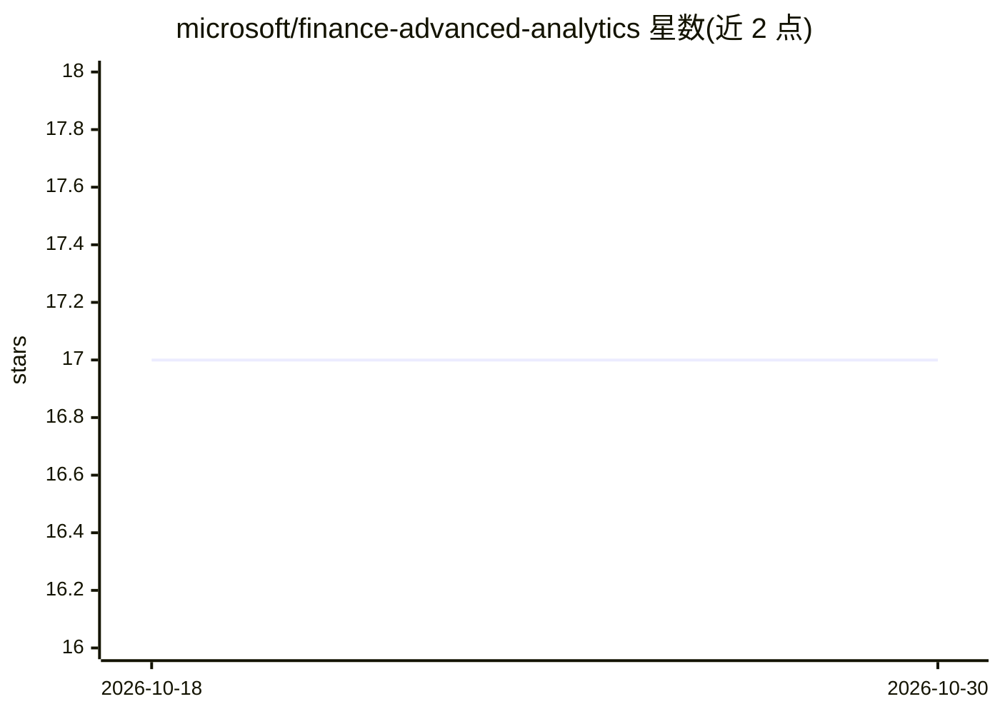

# microsoft/finance-advanced-analytics

⭐ 17 · TeX · 推送 2026-09-15 · [GitHub](https://github.com/microsoft/finance-advanced-analytics) · [官网](https://microsoft.github.io/finance-advanced-analytics/) · 组织维护

**微软财务高级分析团队的解决方案示例与学习内容仓库**

由 Microsoft Finance 高级分析专家团队维护的展示型仓库，收录解决方案示例与学习内容，主题涵盖财务预测、时间序列与机器学习。README 仅含贡献与商标说明，未提供具体安装运行方式或功能细节，实际内容需查看仓库目录。面向财务分析领域的数据科学与分析从业者。

## 筛选速览

| 维度 | 判定 | 备注 |
|---|---|---|
| AI 角色 | `ai-knowledge` | 知识聚合/清单类 |
| 许可风险 | `none` | — |
| 部署形态 | `None` |  |
| 模型依赖 | — | README 未给出锁定关系 |
| 硬件要求 | — | 无带数字的原话,不猜 |
| 安装摩擦 | `low` | 无编译、无系统依赖或容器化 |
| 成熟度 | — | 结构信号不足 |

## 能力要点

- 收录财务领域解决方案示例与学习内容
- 主题涵盖预测、时间序列与机器学习
- 由微软财务内部专家团队策展

## 适用场景

- 学习财务分析场景下的预测与时间序列方法
- 参考微软财务团队的实际解决方案示例

## 场景标签

`教程课程` · 领域:学习与行业

## 证据(README 行号)

> L3: Repo to showcase solution examples and learning content curated by the advanced analytics experts within Microsoft F

## 星数曲线

2026-10-18 17 → 2026-10-30 17（+0）

---
*卡片 v1 · prompt 1.4 · 生成 2026-10-29 · 置信度 low · 依据 README sha `f3141b147686` · [字段定义](../../DATASET.md)*
