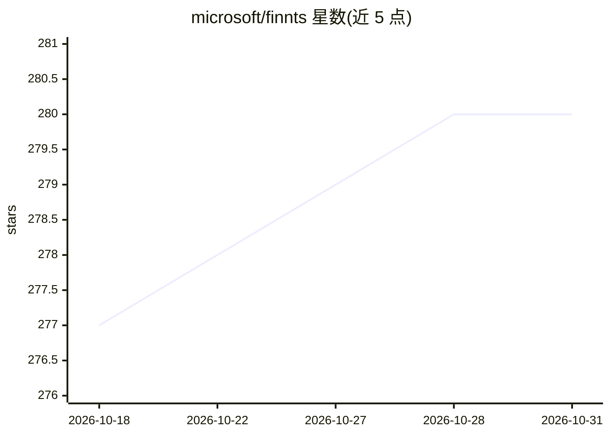

# microsoft/finnts

⭐ 280 · R · NOASSERTION · 推送 2026-10-30 · [GitHub](https://github.com/microsoft/finnts) · [官网](https://microsoft.github.io/finnts) · 组织维护

**微软开源的 R 自动化金融时间序列预测框架**

微软维护的 R 包 finnts（Finn），面向企业财务与通用时间序列预测：自动特征工程、特征选择、回测与模型选择，内置 25+ 单变量与多变量模型，支持日/周/月/季/年粒度，可接入外部回归变量，并可通过 Azure 并行运行数千条时间序列。另内置一个 AI agent 充当虚拟数据科学家，持续优化预测精度；提供 Finn skill 让 GitHub Copilot/Codex 等编码代理直接安装并运行预测。通过 CRAN 或 GitHub 安装。

## 筛选速览

| 维度 | 判定 | 备注 |
|---|---|---|
| AI 角色 | `ai-native` | 本体是模型或模型工具 |
| 许可风险 | `none` | NOASSERTION |
| 部署形态 | `None` |  |
| 模型依赖 | — | README 未给出锁定关系 |
| 硬件要求 | — | 无带数字的原话,不猜 |
| 安装摩擦 | `low` | 无编译、无系统依赖或容器化 |
| 成熟度 | — | 结构信号不足 |

## 能力要点

- 自动特征工程、特征选择、回测与模型选择
- 25+ 单变量与多变量模型，Azure 云端并行运行
- 内置 AI agent 作为虚拟数据科学家优化预测
- Finn skill 让编码代理（Copilot/Codex）代为运行预测

## 适用场景

- 企业财务数据自动化预测（收入、支出等）
- 批量并行预测数千条时间序列
- 不想写 R 代码时，让编码代理帮我跑预测

## 场景标签

`金融量化` · 领域:学习与行业

## 证据(README 行号)

> L5: The Microsoft Finance Time Series Forecasting Framework, aka finnts or Finn, is an automated forecasting framework f
> L7: - Built in AI agent that can act as your own virtual data scientist, always optimizing for the most accurate forecas

## 星数曲线

2026-10-18 277 → 2026-10-31 280（+3）

---
*卡片 v1 · prompt 1.4 · 生成 2026-10-22 · 置信度 high · 依据 README sha `661b7eb4e7db` · [字段定义](../../DATASET.md)*
