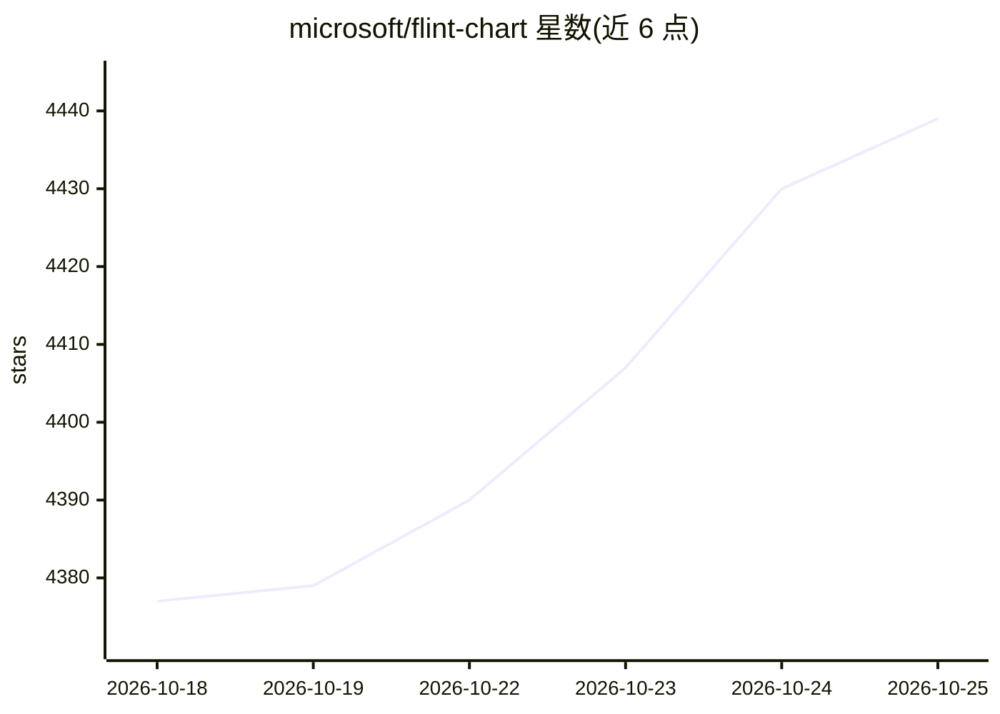

# microsoft/flint-chart

⭐ 4,439 · TypeScript · MIT · 推送 2026-10-22 · [GitHub](https://github.com/microsoft/flint-chart) · [官网](https://microsoft.github.io/flint-chart/) · 组织维护 · 中文 README

**面向 AI agent 的可视化中间语言，把简洁图表规格编译为多后端图表**

Flint 是一种可视化中间语言：AI agent 或开发者给出简短、人类可编辑的图表语义规格（70+ 语义类型如 Rank/Price/Country），Flint 推导比例尺、坐标轴、布局、标签等决策，并编译为 Vega-Lite、ECharts、Chart.js、Plotly 原生规格或可编辑 Excel 图表。同一输入可切换多个后端，支持内置与自定义视觉主题。仓库含两个组件：TypeScript 库 flint-chart 与 MCP 服务器 flint-chart-mcp，后者供 GitHub Copilot、Claude 等 MCP 客户端中的 agent 在对话内创建、校验并渲染图表。限制：Python 包尚未发布（当前为源码预览），主题目前仅作用于 Vega-Lite 输出。

## 筛选速览

| 维度 | 判定 | 备注 |
|---|---|---|
| AI 角色 | `ai-ecosystem` | LLM/agent 周边工具 |
| 许可风险 | `permissive` | MIT |
| 部署形态 | `library` | 以包/库形式分发 |
| 模型依赖 | — | README 未给出锁定关系 |
| 硬件要求 | — | 无带数字的原话,不猜 |
| 安装摩擦 | `low` | 无编译、无系统依赖或容器化 |
| 成熟度 | — | 结构信号不足 |

## 能力要点

- 一份语义规格编译到 Vega-Lite/ECharts/Chart.js/Plotly/Excel 五种后端
- 70+ 语义字段类型与自动布局推导
- 10 个内置视觉主题（Economist/Swiss/Pop 等），支持继承与覆盖
- MCP 服务器供 agent 在对话内创建、校验、渲染图表，支持 PNG/SVG 输出

## 适用场景

- 让 AI agent 在对话中直接生成可交互图表
- 用同一份图表规格在多个图表库间切换输出
- 以主题系统统一品牌或刊物风格的图表呈现

## 场景标签

`数据分析` · 领域:效率与自动化

## 证据(README 行号)

> L13: Flint is a visualization intermediate language that lets **AI agents turn
> L28: - **`flint-chart-mcp`**: an MCP server that lets agents create, validate, and
> L29:  render charts directly from a chat or coding environment.

## 星数曲线

2026-10-18 4,377 → 2026-10-25 4,439（+62）

---
*卡片 v1 · prompt 1.4 · 生成 2026-10-20 · 置信度 high · 依据 README sha `497273b312c6` · [字段定义](../../DATASET.md)*
