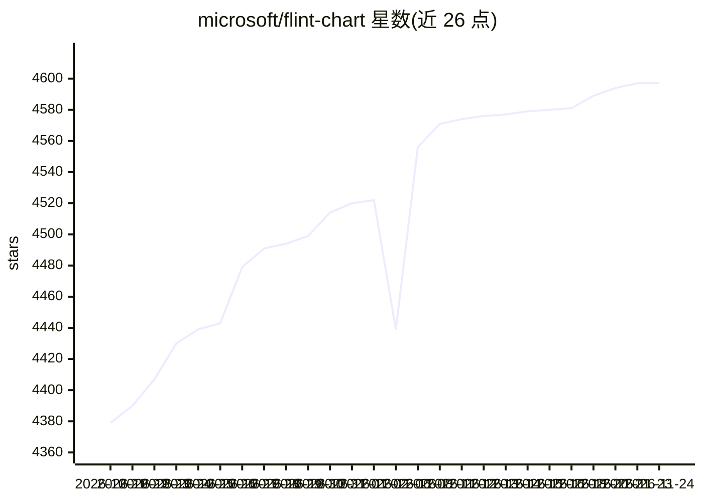

# microsoft/flint-chart

⭐ 4,597 · TypeScript · MIT · 推送 2026-11-22 · [GitHub](https://github.com/microsoft/flint-chart) · [官网](https://microsoft.github.io/flint-chart/) · 组织维护 · 中文 README

**让 AI agent 从人可编辑的 spec 可靠生成图表的可视化语言**

Flint 是一种图表描述语言与编译器：spec 包含数据、语义类型、图表、主题与交互规格，编译器解析各部分并组合成后端所需完整 spec，减轻手写冗长低层配置的负担。可用作 MCP server 接入 agent（GitHub Copilot、Claude Code、Codex、Cursor 等），也可作为 npm 库嵌入应用；支持 52 种图表类型、5 种渲染后端（Vega-Lite、ECharts、Chart.js、Plotly、Excel）、14 主题预设与 23 交互预设。npm 安装，React 为可选 peer；Python 移植版处于预览阶段未发布。

## 筛选速览

| 维度 | 判定 | 备注 |
|---|---|---|
| AI 角色 | `ai-ecosystem` | LLM/agent 周边工具 |
| 许可风险 | `permissive` | MIT |
| 部署形态 | `library` | 以包/库形式分发 |
| 模型依赖 | — | README 未给出锁定关系 |
| 硬件要求 | — | 无带数字的原话,不猜 |
| 安装摩擦 | `low` | 无编译、无系统依赖或容器化 |
| 成熟度 | — | 结构信号不足 |

## 能力要点

- 52 种图表类型，同一 spec 编译到 5 种后端（Vega-Lite/ECharts/Chart.js/Plotly/Excel）
- 字段携带 Rank/YearMonth/Delta 等语义类型，编译器据此推断解析、轴、格式与颜色
- 14 主题预设（Economist、Swiss 等）可继承扩展品牌样式，23 种交互预设（brushing、hover 等）
- 以 MCP server 接入 agent，返回实时图表或 PNG/SVG/后端原生 spec

## 适用场景

- 让编码 agent 在对话中按自然语言生成交互式图表
- 在应用内用一份 spec 跨后端渲染图表
- 按出版物或品牌风格统一图表外观

## 场景标签

`数据分析` · 领域:效率与自动化

## 证据(README 行号)

> L14: Flint lets AI agents **reliably create expressive, good-looking and interactive
> L19: Use it as an MCP server with your
> L21: app. Flint supports **52 chart types across 5 rendering backends**

## 星数曲线

2026-10-21 4,379 → 2026-11-24 4,597（+218）

---
*卡片 v1 · prompt 1.4 · 生成 2026-11-22 · 置信度 high · 依据 README sha `9c2e10bce68d` · [字段定义](../../DATASET.md)*
