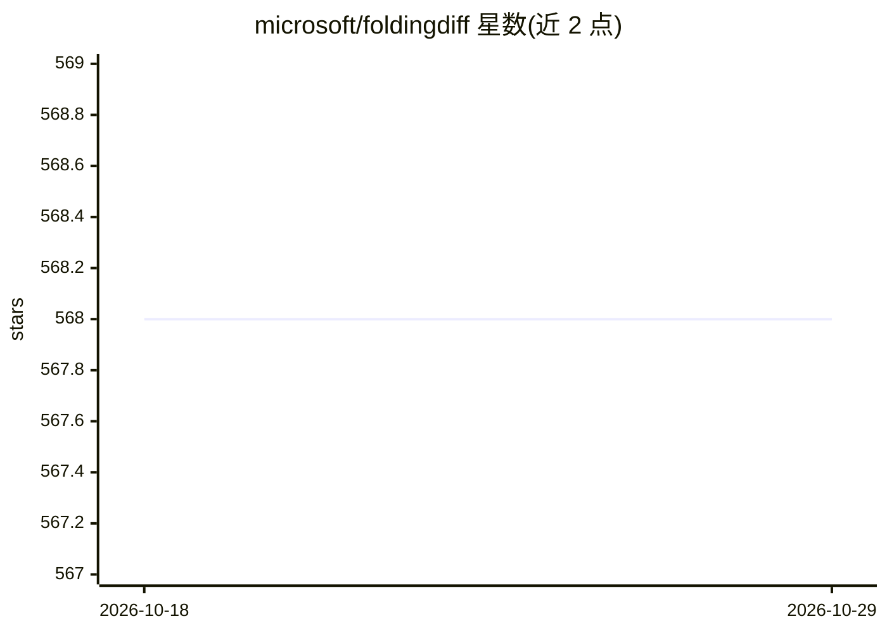

# microsoft/foldingdiff

⭐ 568 · Jupyter Notebook · MIT · 推送 2026-09-09 · [GitHub](https://github.com/microsoft/foldingdiff) · [官网](https://www.nature.com/articles/s41467-024-45051-2) · 组织维护

**科研者用的蛋白质骨架生成扩散模型（PyTorch 实现）**

基于扩散模型生成全新蛋白质主链骨架的科研代码库，用 PyTorch、PyTorch Lightning 与 HuggingFace transformers 实现。提供在 CATH 数据集上训练的预训练权重（托管于 HuggingFace hub，wukevin/foldingdiff_cath），可用 bin/sample.py 采样指定长度范围的骨架并输出角度 CSV 与 PDB 文件；也支持自行训练、TM-score 评估、PyMOL 折叠过程可视化，以及通过 ProteinMPNN/ESM-IF1 逆折叠与 OmegaFold/AlphaFold2 评估可设计性。通过 git clone 与 conda 环境安装，GPU 采样较快、CPU 可运行但很慢。

## 筛选速览

| 维度 | 判定 | 备注 |
|---|---|---|
| AI 角色 | `ai-native` | 本体是模型或模型工具 |
| 许可风险 | `permissive` | MIT |
| 部署形态 | `library` | 以包/库形式分发 |
| 模型依赖 | — | README 未给出锁定关系 |
| 硬件要求 | — | 无带数字的原话,不猜 |
| 安装摩擦 | `medium` | 含编译或系统依赖之一 |
| 成熟度 | — | 结构信号不足 |

## 能力要点

- 扩散模型生成蛋白质主链骨架，基于 PyTorch Lightning 实现
- 提供 CATH 数据集训练的预训练权重（HuggingFace hub）
- bin/sample.py 按长度范围采样骨架，输出角度 CSV 与 PDB 文件
- 配套逆折叠（ProteinMPNN/ESM-IF1）与 scTM 评估、折叠过程 GIF 可视化脚本

## 适用场景

- 采样生成指定长度范围的新型蛋白质骨架结构
- 在 CATH 数据集上训练自己的蛋白质骨架扩散模型
- 评估生成骨架的可设计性（逆折叠+结构预测自洽性）

## 场景标签

`科研工具` `模型训练` · 领域:学习与行业

## 证据(README 行号)

> L1: # foldingdiff - Diffusion model for protein backbone generation
> L5: We present a diffusion model for generating novel protein backbone structures. For more details, see our preprint on
> L68: python ~/projects/foldingdiff/bin/sample.py -l 50 128 -n 10 -b 512 --device cuda:0

## 星数曲线

2026-10-18 568 → 2026-10-29 568（+0）

---
*卡片 v1 · prompt 1.4 · 生成 2026-10-21 · 置信度 mid · 依据 README sha `4b620b363d08` · [字段定义](../../DATASET.md)*
