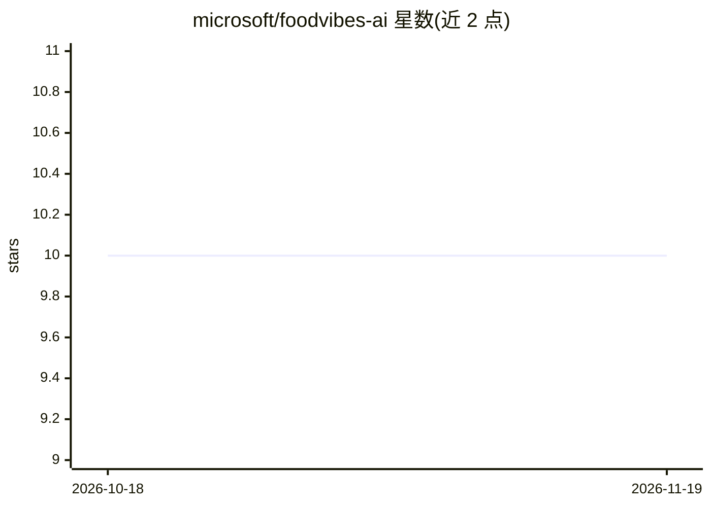

# microsoft/foodvibes-ai

⭐ 10 · TypeScript · MIT · 推送 2026-09-22 · [GitHub](https://github.com/microsoft/foodvibes-ai) · 组织维护

**面向企业的食品供应链溯源追踪平台**

foodvibes-ai 是一个供应链追踪平台，针对欧盟零毁林产品法规（EUDR）、美国 FDA FSMA 等要求，对产品进行从产地到终端的地理定位与时间追踪。平台基于不可变账本记录地理、产品与流转信息（3W 追踪），提供基于角色的数据访问控制，并可连接 Azure Data Manager for Agriculture 与 FarmVibes.ai 获取遥感洞察（如毁林分析、天气信息）。通过 Docker 脚本安装，亦可适配食品以外的其他供应链场景。

## 筛选速览

| 维度 | 判定 | 备注 |
|---|---|---|
| AI 角色 | `ai-enhanced` | 去掉 AI 部分产品仍成立 |
| 许可风险 | `permissive` | MIT |
| 部署形态 | `None` |  |
| 模型依赖 | — | README 未给出锁定关系 |
| 硬件要求 | — | 无带数字的原话,不猜 |
| 安装摩擦 | `low` | 无编译、无系统依赖或容器化 |
| 成熟度 | — | 结构信号不足 |

## 能力要点

- 基于不可变账本的 3W（When/What/Where）追踪，由三个账本组成
- 基于角色与产品关联的信息可见性控制
- 连接 FarmVibes.ai 获取卫星遥感洞察（毁林分析等）
- 面向 EUDR、FSMA 等法规的合规追踪

## 适用场景

- 为 EUDR 合规追踪咖啡等产品从产地到成品的地理与时间信息
- 追踪供应链节点的存储温度、认证等位置关联信息
- 通过卫星数据评估供应链地点的毁林与土地退化情况
- 将溯源机制适配到食品以外的全球供应链

## 场景标签

 · 领域:供应链/农业食品

## 证据(README 行号)

> L18: Supply Chain Tracking platform for the European Union’s Deforestation-free product regulation (EUDR), the FDA’s Foo
> L26: foodvibes-ai provides the building blocks for enabling end-to-end traceability in Supply Chains. It was built with 
> L39: - **Remote sensing insights:** It also connects with FarmVibes.ai, which is an opensourced satellite-based geospati

## 星数曲线

2026-10-18 10 → 2026-11-19 10（+0）

---
*卡片 v1 · prompt 1.4 · 生成 2026-11-19 · 置信度 mid · 依据 README sha `6afbd527247e` · [字段定义](../../DATASET.md)*
