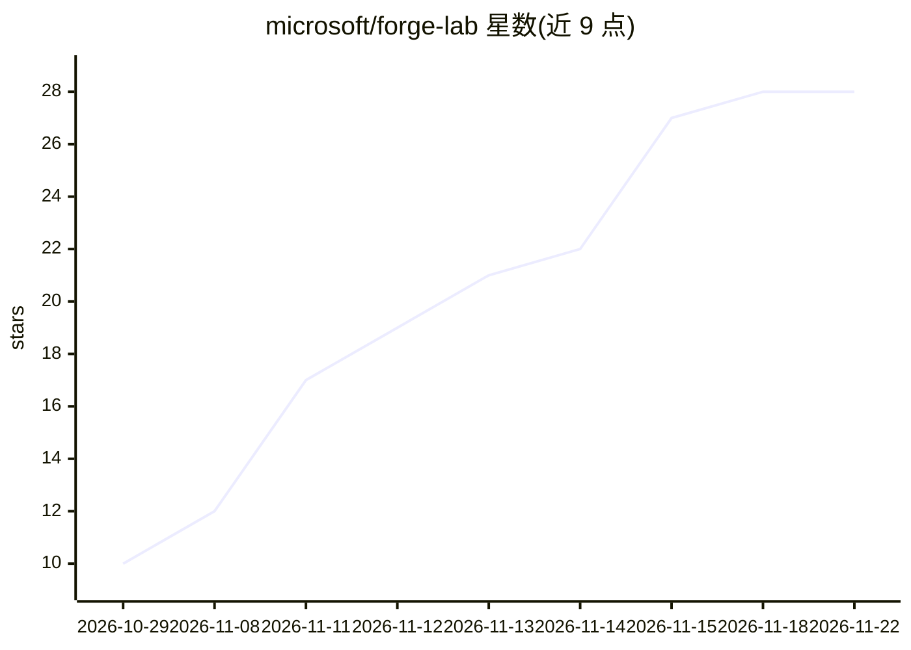

# microsoft/forge-lab

⭐ 28 · JavaScript · CC-BY-4.0 · 推送 2026-11-18 · [GitHub](https://github.com/microsoft/forge-lab) · 组织维护

**微软 FORGE 实验室公开披露的 CVE 漏洞清单数据集**

微软安全部 Frontier Offensive Research & Generative Exploitation (FORGE) 实验室维护的公开漏洞披露仓库：以累积数据集形式发布经批准公开的 CVE 发现，机器可读清单存放于 cve/cve.json，随披露许可持续更新。仓库不含第三方源码或软件组件，CVE 标识符指向 CVE Program 与 CVE 编号机构发布的标准化漏洞记录。提供贡献指南与安全漏洞上报指引（禁止通过公开 GitHub issue 上报）。

## 筛选速览

| 维度 | 判定 | 备注 |
|---|---|---|
| AI 角色 | `ai-knowledge` | 知识聚合/清单类 |
| 许可风险 | `viral` | CC-BY-4.0 |
| 部署形态 | `None` |  |
| 模型依赖 | — | README 未给出锁定关系 |
| 硬件要求 | — | 无带数字的原话,不猜 |
| 安装摩擦 | `low` | 无编译、无系统依赖或容器化 |
| 成熟度 | — | 结构信号不足 |

## 能力要点

- 机器可读 CVE 清单：cve/cve.json
- 累积数据集，随披露批准持续更新
- 仅收录已获准公开披露的 CVE 标识符

## 适用场景

- 查询 FORGE 实验室披露的漏洞记录
- 以机器可读方式集成 CVE 数据用于安全分析

## 场景标签

`网络安全` · 领域:学习与行业

## 证据(README 行号)

> L8: The CVE list is maintained as a cumulative dataset and updated as findings are
> L14: `cve/cve.json`.

## 星数曲线

2026-10-29 10 → 2026-11-22 28（+18）

---
*卡片 v1 · prompt 1.4 · 生成 2026-11-18 · 置信度 mid · 依据 README sha `8a8d0644227e` · [字段定义](../../DATASET.md)*
