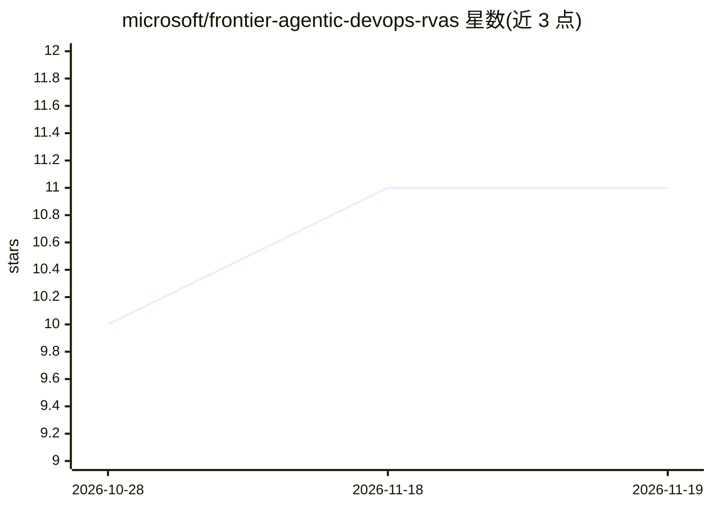

# microsoft/frontier-agentic-devops-rvas

⭐ 11 · JavaScript · MIT · 推送 2026-11-13 · [GitHub](https://github.com/microsoft/frontier-agentic-devops-rvas) · [官网](https://microsoft.github.io/frontier-agentic-devops-rvas) · 组织维护

**Agentic DevSecOps 动手实践课程目录与 GitHub 企业配置技能**

微软发布的教程/课程仓库：围绕 GitHub Enterprise Cloud、Advanced Security、Agentic Workflows 与 Azure SRE Agent 组织 4 种成果路径和 3 个模块、共 57 项活动，提供活动目录、会话构建器和本地站点构建流程（Node.js ≥18，无 npm install）。附带一个 GitHub Copilot CLI 插件，可在 Plan/Apply 流程中辅助完成 GitHub Enterprise 配置。插件尚缺端到端现场验证，仅限自备环境使用。

## 筛选速览

| 维度 | 判定 | 备注 |
|---|---|---|
| AI 角色 | `ai-knowledge` | 知识聚合/清单类 |
| 许可风险 | `permissive` | MIT |
| 部署形态 | `library` | 以包/库形式分发 |
| 模型依赖 | — | README 未给出锁定关系 |
| 硬件要求 | — | 无带数字的原话,不猜 |
| 安装摩擦 | `low` | 无编译、无系统依赖或容器化 |
| 成熟度 | `idea` | |

## 能力要点

- 4 种成果路径 × 3 个模块的课程目录（57 项活动）
- 本地构建生成站点数据与依赖图 JSON，带目录校验与内容审计脚本
- GitHub Copilot CLI 的 github-enterprise-setup 配置插件（Plan/Apply 分步确认）
- 外部实验环境（OWASP Juice Shop 等）以 git submodule 按需获取

## 适用场景

- 团队按成果路径组织 DevSecOps 动手培训会话
- 为企业环境规划 GitHub Advanced Security 采用与平台迁移
- 通过 Copilot CLI 技能辅助完成 GitHub Enterprise 初始配置

## 场景标签

`教程课程` · 领域:学习与行业

## 证据(README 行号)

> L3: **Learn by doing** through four outcomes and three modules,
> L49: The build generates the site data from activity metadata and outcomes. Don't copy metadata by hand.

## 星数曲线

2026-10-28 10 → 2026-11-19 11（+1）

---
*卡片 v1 · prompt 1.4 · 生成 2026-11-18 · 置信度 high · 依据 README sha `a0f8654c4834` · [字段定义](../../DATASET.md)*
