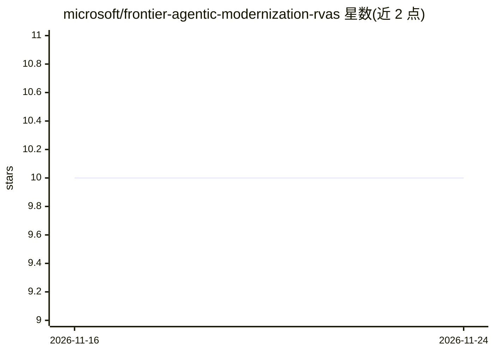

# microsoft/frontier-agentic-modernization-rvas

⭐ 10 · JavaScript · MIT · 推送 2026-11-18 · [GitHub](https://github.com/microsoft/frontier-agentic-modernization-rvas) · [官网](https://microsoft.github.io/frontier-agentic-modernization-rvas/) · 组织维护

**用 GitHub Copilot 与 Azure 评估和改造遗留应用的工作坊工具链**

微软发布的 Agentic Modernization 仓库，为黑客松/工作坊场景提供遗留应用现代化路线：Replatform & refactor 路线使用 `modernize assess/plan` CLI 与 .NET、Java 示例应用（ContosoUniversity、PhotoAlbum、eShopOnWeb），迁移到 .NET 10 / Java 25 并接入 Azure Service Bus、Blob Storage、Container Apps；Rearchitect & rebuild 路线提供可安装到 GitHub Copilot CLI 或 VS Code 的插件，产出九件规划工件并按选定工作流重建应用。挑战覆盖评估、改造、容器化、数据库迁移、可观测与安全，并含 Azure OpenAI 拓展挑战。

## 筛选速览

| 维度 | 判定 | 备注 |
|---|---|---|
| AI 角色 | `ai-ecosystem` | LLM/agent 周边工具 |
| 许可风险 | `permissive` | MIT |
| 部署形态 | `desktop` | 安装包/桌面程序 |
| 模型依赖 | locked-api |  |
| 硬件要求 | — | 无带数字的原话,不猜 |
| 安装摩擦 | `low` | 无编译、无系统依赖或容器化 |
| 成熟度 | — | 结构信号不足 |

## 能力要点

- `modernize assess` 评估遗留代码库迁移复杂度，`modernize plan create/execute` 生成并执行迁移计划
- 插件包含 azure-app-modernization、azure-app-rebuild、cloud-architecture-diagram 三个技能及 Microsoft Learn MCP
- .NET 与 Java 双示例轨道，目标为 Azure Container Apps + Terraform 部署
- 客户自有代码轨道：同一 CLI 工作流应用于真实遗留代码库

## 适用场景

- 在黑客松中把 .NET Framework 或 Java 8 遗留应用迁移到现代运行时
- 用 Copilot 插件对遗留应用做架构分析与重建规划
- 练习容器化并部署到 Azure Container Apps 与数据库上云

## 场景标签

`编码 Agent` `教程课程` · 领域:编码与开发

## 证据(README 行号)

> L24: For **Replatform & refactor**, use the **GitHub Copilot Modernization** tools across these tracks:
> L142: alone cannot solve. Use the **Agentic Modernization** plugin, not the `modernize` CLI.
> L171: Once the plugin is published, install it in GitHub Copilot CLI:

## 星数曲线

2026-11-16 10 → 2026-11-24 10（+0）

---
*卡片 v1 · prompt 1.4 · 生成 2026-11-19 · 置信度 mid · 依据 README sha `7e65913eed43` · [字段定义](../../DATASET.md)*
