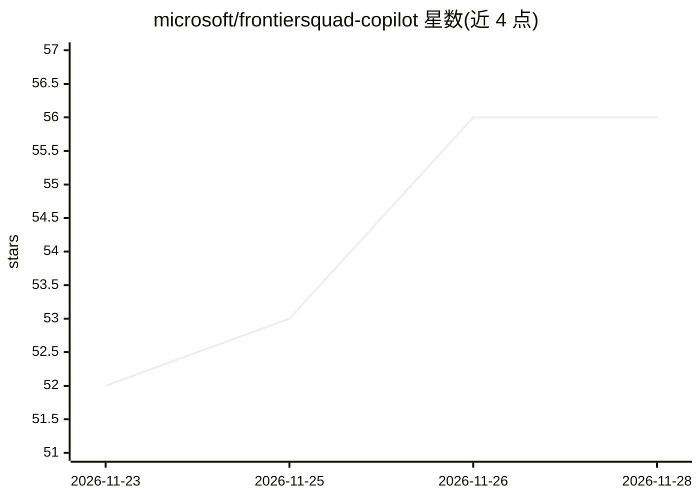

# microsoft/frontiersquad-copilot

⭐ 56 · MIT · 推送 2026-11-22 · [GitHub](https://github.com/microsoft/frontiersquad-copilot) · [官网](https://aka.ms/devsquad-copilot) · 组织维护

**面向开发团队的 GitHub Copilot 敏捷交付框架**

为 GitHub Copilot 构建的交付框架，通过 envisioning、spec、ADR、任务分解等持久化工件串联从业务意图到实现的流程，由 conductor agent 调度 13 个子代理完成规划、TDD 实现、评审与安全扫描，并支持规范中途修订。适用于多人共享决策与待办协调的团队；不支持一次性全自动生成代码。VS Code 与 GitHub Copilot CLI 可安装，唯一前置依赖是 Node.js。

## 筛选速览

| 维度 | 判定 | 备注 |
|---|---|---|
| AI 角色 | `ai-ecosystem` | LLM/agent 周边工具 |
| 许可风险 | `permissive` | MIT |
| 部署形态 | `None` |  |
| 模型依赖 | — | README 未给出锁定关系 |
| 硬件要求 | — | 无带数字的原话,不猜 |
| 安装摩擦 | `low` | 无编译、无系统依赖或容器化 |
| 成熟度 | `idea` | |

## 能力要点

- conductor agent 调度 13 个专业化子代理的代理工作流
- 规范与 ADR 作为持久化工件，支持实现中途修订
- 按影响分级的人机协同（低影响直行、高影响需批准+ADR）
- 仅依赖 Node.js，无专属 CLI 或语言工具链

## 适用场景

- 多人团队通过持久化 spec/ADR 追踪架构决策
- 用 TDD 纪律让代理按切片逐步实现功能
- 在 Azure DevOps/GitHub Issues 中管理代理产出的工作项

## 场景标签

`编码 Agent` `多智能体` `Agent 框架` · 领域:Agent 开发

## 证据(README 行号)

> L3: A delivery framework for GitHub Copilot with agents that guide teams from **business intent** to **implementation**,
> L32: The loop is the unit of delivery. The whole system is orchestrated by a conductor agent that guides developers and 

## 星数曲线

2026-11-23 52 → 2026-11-28 56（+4）

---
*卡片 v1 · prompt 1.4 · 生成 2026-11-23 · 置信度 high · 依据 README sha `287ddd045a43` · [字段定义](../../DATASET.md)*
