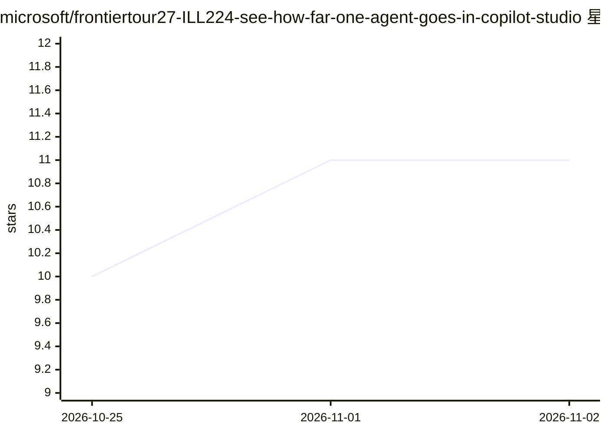

# microsoft/frontiertour27-ILL224-see-how-far-one-agent-goes-in-copilot-studio

⭐ 11 · PowerShell · MIT · 推送 2026-10-30 · [GitHub](https://github.com/microsoft/frontiertour27-ILL224-see-how-far-one-agent-goes-in-copilot-studio) · 组织维护

**Copilot Studio 构建 Supplier Assurance Agent 的动手实验课程材料**

Microsoft Frontier Tour 2027 的 ILL224 课程配套仓库，面向课程学员与自学者的动手实验（hands-on lab）：在 Microsoft Copilot Studio 中构建一个 Supplier Assurance Agent，流程涵盖接入受治理的 SharePoint 知识、SharePoint MCP 实时操作、可复用 agent 技能、沙箱 Python、记忆、评测与工作流发布，并以一次发票审核为例贯穿全程。实验可经讲师提供的 Skillable 环境进行，或克隆仓库后自行配置所需服务；仓库含参会者指引、环境搭建与讲师交付资源，全部供应商/发票数据为虚构实验数据。

## 筛选速览

| 维度 | 判定 | 备注 |
|---|---|---|
| AI 角色 | `ai-knowledge` | 知识聚合/清单类 |
| 许可风险 | `permissive` | MIT |
| 部署形态 | `None` |  |
| 模型依赖 | — | README 未给出锁定关系 |
| 硬件要求 | — | 无带数字的原话,不猜 |
| 安装摩擦 | `low` | 无编译、无系统依赖或容器化 |
| 成熟度 | — | 结构信号不足 |

## 能力要点

- 构建基于 SharePoint 知识与 MCP 操作的 Copilot Studio agent
- 含沙箱 Python 技能、记忆、评测与工作流发布环节
- 以发票审核场景为主线到人工审核建议的完整流程
- 提供 Skillable 引导环境与自学两种参与方式

## 适用场景

- 参加 ILL224 课程并完成配套实验
- 自学在 Copilot Studio 中构建带治理与评测的 agent
- 讲师获取演示材料与交付指引

## 场景标签

`教程课程` · 领域:学习与行业

## 证据(README 行号)

> L9: Build a Supplier Assurance Agent in Microsoft Copilot Studio that combines governed SharePoint knowledge, live Share
> L25: ### Learning outcomes
> L43: - Attendee instructions

## 星数曲线

2026-10-25 10 → 2026-11-02 11（+1）

---
*卡片 v1 · prompt 1.4 · 生成 2026-11-02 · 置信度 high · 依据 README sha `81025948e76d` · [字段定义](../../DATASET.md)*
