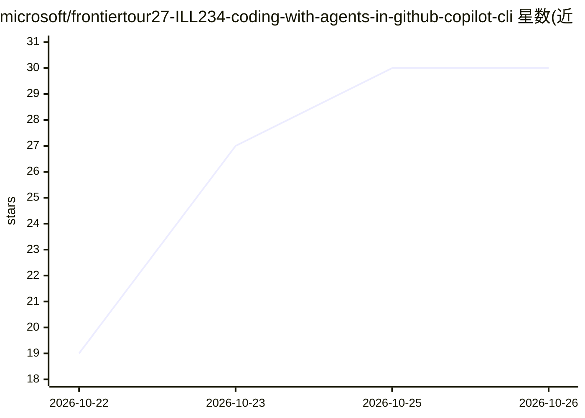

# microsoft/frontiertour27-ILL234-coding-with-agents-in-github-copilot-cli

⭐ 30 · MIT · 推送 2026-10-15 · [GitHub](https://github.com/microsoft/frontiertour27-ILL234-coding-with-agents-in-github-copilot-cli) · 组织维护

**Microsoft Frontier Tour 2027 课程仓库：用 Copilot CLI 学 agent 编码**

Microsoft Frontier Tour 2027 的动手实验课程（ILL234）配套仓库：围绕 Caldova Careers 示例应用，指导学员配置 GitHub Copilot CLI 与仓库自定义指令、规划和实现筛选功能、定制质量检查技能、用 Playwright MCP 与 QA agent 验证功能，并以 Agent Merge 交付变更。含 11 个按序练习、讲师交付指引和后续学习资源链接。面向参加课程或自学的开发者。

## 筛选速览

| 维度 | 判定 | 备注 |
|---|---|---|
| AI 角色 | `ai-knowledge` | 知识聚合/清单类 |
| 许可风险 | `permissive` | MIT |
| 部署形态 | `None` |  |
| 模型依赖 | — | README 未给出锁定关系 |
| 硬件要求 | — | 无带数字的原话,不猜 |
| 安装摩擦 | `low` | 无编译、无系统依赖或容器化 |
| 成熟度 | — | 结构信号不足 |

## 能力要点

- 11 个按序练习，基于 Caldova Careers 示例应用
- 覆盖 custom instructions、agent skills、custom agents、Playwright MCP 与 Agent Merge
- 提供讲师交付指引（delivery-resources/）

## 适用场景

- 参加 Frontier Tour 课程后跟随练习
- 自学 GitHub Copilot CLI 的 agent 工作流
- 讲师获取讲义与授课指引

## 场景标签

`教程课程` · 领域:学习与行业

## 证据(README 行号)

> L9: Build features in the Caldova Careers sample application with GitHub Copilot CLI while learning how to give an agent
> L29: ### 🎯 Learning outcomes

## 星数曲线

2026-10-22 19 → 2026-10-26 30（+11）

---
*卡片 v1 · prompt 1.4 · 生成 2026-10-26 · 置信度 high · 依据 README sha `2d5a5141dc73` · [字段定义](../../DATASET.md)*
