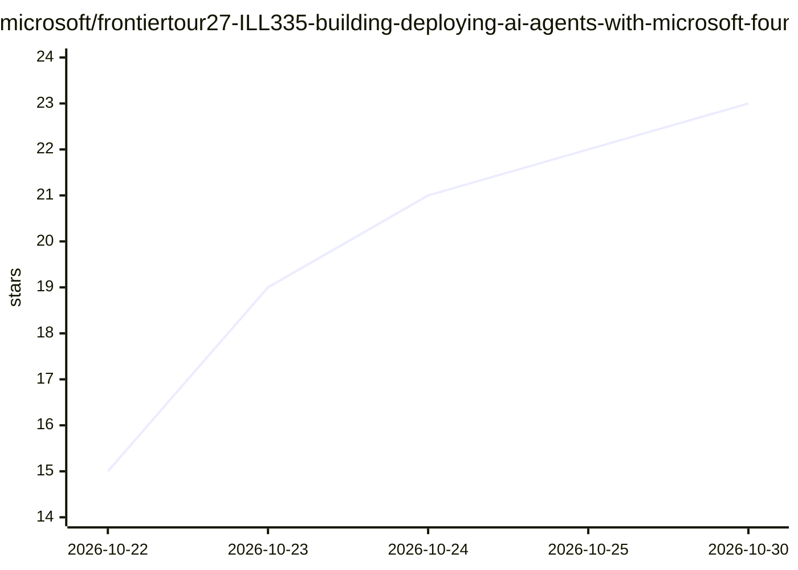

# microsoft/frontiertour27-ILL335-building-deploying-ai-agents-with-microsoft-foundry

⭐ 23 · Python · MIT · 推送 2026-10-21 · [GitHub](https://github.com/microsoft/frontiertour27-ILL335-building-deploying-ai-agents-with-microsoft-foundry) · 组织维护

**微软 Frontier Tour 2027 动手实验：用 Foundry 构建部署 AI Agent**

微软 Frontier Tour 2027 课程 ILL335 的配套动手实验仓库：以虚构制药公司 Caldova 的消费者情感分析工具为场景，引导学员在 Microsoft Foundry 发现并预配托管模型、用 Azure AI Projects SDK 与 OpenAI 兼容客户端完成首次推理、构建带人工审核路由的情感分析流水线，并用 Microsoft Agent Framework 与 azd 部署为托管 Agent。全部基于托管服务，无需微调或管理基础设施。提供 docs/ 分模块实验文档、GitHub Codespaces 与 Dev Container 环境，含讲者交付资源。

## 筛选速览

| 维度 | 判定 | 备注 |
|---|---|---|
| AI 角色 | `ai-knowledge` | 知识聚合/清单类 |
| 许可风险 | `permissive` | MIT |
| 部署形态 | `None` |  |
| 模型依赖 | — | README 未给出锁定关系 |
| 硬件要求 | — | 无带数字的原话,不猜 |
| 安装摩擦 | `low` | 无编译、无系统依赖或容器化 |
| 成熟度 | — | 结构信号不足 |

## 能力要点

- 在 Microsoft Foundry 发现/预配托管模型并发起推理调用
- 构建带受监管信号人工审核路由的情感分析流水线
- 以 Microsoft Agent Framework 和 azd up 部署托管 Agent
- 提供 Codespaces / Dev Container 预构建环境与讲者交付资源

## 适用场景

- 跟课或自学完成 AI Agent 构建与部署的动手实验
- 了解 Azure AI Projects SDK 与 Foundry Agent Service 的使用流程
- 讲者获取课件、演示笔记与交付指引

## 场景标签

`教程课程` · 领域:学习与行业

## 证据(README 行号)

> L9: Step into the role of an AI developer on Caldova's commercial digital and customer engagement team and build a B2C c
> L42: - Discover, provision, and connect to hosted models in Microsoft Foundry using the Azure AI Projects SDK and OpenAI
> L44: - Deploy application logic as a hosted agent on Foundry Agent Service using the Microsoft Agent Framework, the `mic

## 星数曲线

2026-10-22 15 → 2026-10-30 23（+8）

---
*卡片 v1 · prompt 1.4 · 生成 2026-10-27 · 置信度 high · 依据 README sha `0b36ff94a4f3` · [字段定义](../../DATASET.md)*
